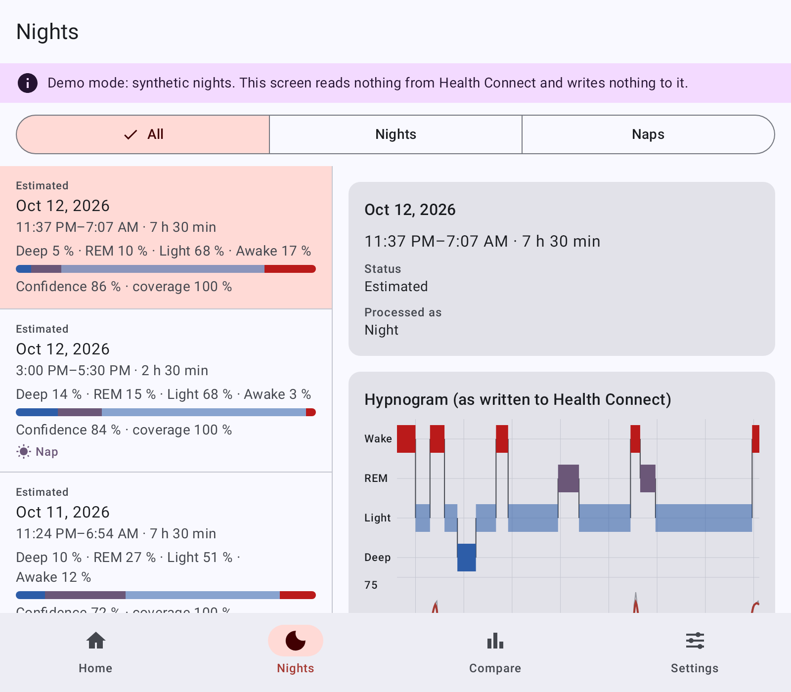
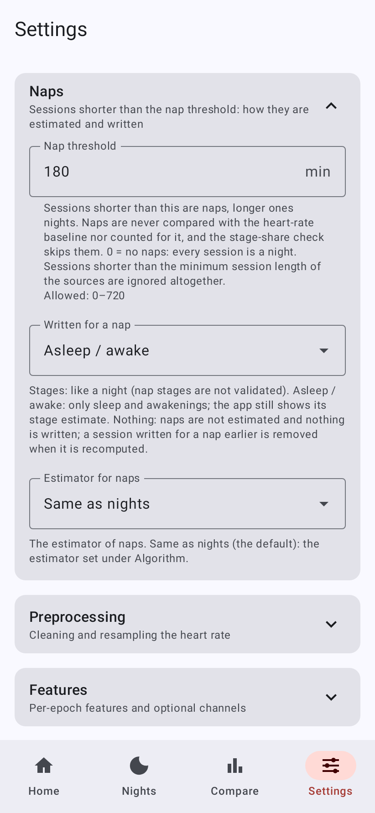

# PulseStages

[Latest release](https://github.com/alien2003/PulseStages/releases/latest) ·
[Licence: WTFPL](LICENSE) · [User guide](docs/user-guide.md) · [Documentation index](docs/README.md)

## TL;DR

**What it does.** PulseStages estimates your sleep stages (awake, light, deep, REM) from the heart rate that your watch
app writes to Health Connect, and adds them to Health Connect as a separate sleep session titled "Sleep stages from
heart rate (estimate)". Everything happens on the phone: the app has no internet permission and never changes other
apps' data. It is an estimate, not a medical device. You need Android 9 or later and a watch app that writes sleep and
heart rate to Health Connect; the default source is OHealth, the app of OPPO watches.

1. **Install.** On the phone, download `PulseStages-<version>.apk` (not the `-debug` one) from the
   [latest release](https://github.com/alien2003/PulseStages/releases/latest) and open it. When Android asks, allow
   the browser or file manager you opened it with to install apps.
2. **Permissions.** Open PulseStages. On the Home tab tap "Grant permissions" and allow everything. If Home still shows
   "Allow history" (for older nights) or "Allow background", tap them too: without background access, new nights are
   only processed while the app is open. On Android 9–13, if Home offers "Install or update Health Connect", do that
   first.
3. **Watch app.** Make sure it syncs sleep and heart rate to Health Connect (in Health Connect, under "Permissions and
   data" → "App permissions", it must be allowed to write them).
4. **Battery.** Let PulseStages and the watch app run in the background without battery restrictions (Android's
   "Unrestricted" battery setting for each app; phone makers name and place this setting differently).
5. **Optional.** "Backfill history" on Home estimates your past nights. To also estimate daytime naps, lower Settings →
   "Sources" → "Minimum session length" (90 min by default) to e.g. 30 min. In Health Connect → "Permissions and data"
   → "Manage data" → "Data sources and priority", put PulseStages above the watch app for sleep, so that apps using
   Health Connect's sleep totals get the stages (if it is not listed yet, check again after the first estimate).

**Using it.** It runs by itself: an hourly check for new nights and a daily run. Results appear in the Nights tab and
in Health Connect, next to the watch app's own session; "Estimate new" on Home runs it right away. Naps are written to
Health Connect as asleep / awake only by default. **Accuracy:** for nights, fair agreement with a sleep lab (Cohen's κ
about 0.32–0.34), varying strongly between people; nap stages are not validated
([How accurate it is](#how-accurate-it-is)). **Updates:** the app has no update check; install a newer
`PulseStages-<version>.apk` over the installed release, and your data and permissions are kept. Everything else is in
the [Quick start](#quick-start) below and the [user guide](docs/user-guide.md).

---

PulseStages is an Android app that estimates sleep stages (awake, light, deep, REM) from the heart rate that a watch
app writes to [Health Connect](https://developer.android.com/health-and-fitness/health-connect), and writes the result
back to Health Connect as its own sleep session, clearly labelled as an estimate. It was built for an OPPO Watch paired
with OHealth (`com.heytap.health.international`): OHealth writes sleep sessions without stages, only a start and an
end, plus a heart-rate sample about every 2 minutes. PulseStages turns those into a stage-by-stage hypnogram on the
phone, without network access, and never changes or deletes the data of other apps. Daytime naps and nights are
processed in two separate modes; naps are written to Health Connect as asleep / awake by default, because their stage
breakdown is not validated. The output is a statistical estimate, not a measurement, and it is not meant for medical
decisions.

- [TL;DR](#tldr)
- [Screenshots](#screenshots)
- [How accurate it is](#how-accurate-it-is)
- [Quick start](#quick-start)
- [Nights and naps](#nights-and-naps)
- [Features](#features)
- [Documentation](#documentation)
- [Project status](#project-status)
- [Licence](#licence)
- [Acknowledgements and dataset attribution](#acknowledgements-and-dataset-attribution)

## Screenshots

The screenshots contain no real health data. They are rendered on the JVM by `ScreenshotsTest` from synthetic nights
(the debug build's demo data, estimated by the real algorithm with the bundled model) and fixed example states;
[docs/SCREENSHOTS.md](docs/SCREENSHOTS.md) explains how they are made.

| Home | Nights | Night detail |
|---|---|---|
|  |  |  |

| Compare | Settings | Sources |
|---|---|---|
|  |  |  |

On a wide window (the inner screen of a foldable, 600 dp or wider) the Nights tab shows the list and the night detail
side by side:

The Settings group "Naps" decides which sessions are naps and what is written for them:

## How accurate it is

**Nights.** The estimators were validated leave-one-subject-out on the 31 polysomnography (PSG) nights of PhysioNet
sleep-accel (Walch et al.), with the heart rate thinned to one value every 2 minutes as OHealth delivers it; the worse
of two emulations of OHealth's 2-minute value is reported. The default HYBRID estimator reaches Cohen's κ = 0.339 ±
0.169 (mean ± sd over subjects), accuracy 0.612 and macro-F1 0.522; the mean absolute error per night is about 33 min
for deep sleep, 41 min for REM and 19 min for awake. Averaged over four training seeds, the same setup without its
stage-proportion correction scores κ 0.317, so treat about 0.32–0.34 as the expected figure. This is "fair"
agreement. It varies strongly between people (per-subject κ from about −0.03 to 0.65), and single nights can be far
off. The simpler HMM and RULES estimators score κ 0.070 and 0.076.

**Naps.** No public dataset has labelled naps with heart rate. Nap estimates were therefore tested, in pre-registered
experiments, on nap-length windows cut from the sleep-lab and EEG-headband nights and against published stage
compositions of afternoon naps of healthy young adults. In the latest one
([ALGORITHM.md §13.13](ALGORITHM.md#1313-realistic-naps-pre-registered-not-adopted)) no nap stage model passed the
checks. The shipped nap model's REM did not follow the heart rate: its REM share was hardly higher in windows from late
in the night than in windows at sleep onset (1 % of the true difference; at least 25 % was required). Its stage mix was
not realistic either: featureless sessions of 90–135 min got less REM than the published range for naps of that length,
and 60-min windows from late in the night were called at least half deep sleep 23 percentage points more often than the
sleep lab scored them. On windows reweighted to the composition of published naps it was less accurate than calling
every epoch light sleep (by 0.055); the earlier figure of about 6 in 10 epochs right
([§13.12](ALGORITHM.md#1312-a-dedicated-nap-model-pre-registered-adopted)) came almost entirely from windows at sleep
onset. Three new candidate models failed as well: C0 (the shipped model with a level per session length taken from the
published compositions) the REM check and the realism checks, C1 (a model that reads only the heart rate) the check of
sleep-onset deep-sleep discrimination and the realism checks, and C2 (both changes) all three; §13.13 lists every
failing criterion of every model. Naps are therefore written to Health Connect as asleep / awake only: the
pre-registered rule allows that output at a sleep / wake κ of at least 0.20, and the shipped nap model reached κ = 0.27
on held-out nap-length windows of the PSG nights. That κ comes from windows cut from nights; in afternoon recordings of
young adults resting awake it still decoded 60–85 min of sleep where an EEG sleep stager found about 24 min, so the
asleep / awake output relies on the watch's start and end of the nap. **The light / deep / REM breakdown that the app
shows for a nap is not validated.** With the default settings only sessions of 90 min to 3 h are processed as naps
([Nights and naps](#nights-and-naps)); at those lengths, on windows reweighted to the published nap composition, the
shipped nap model's deep and REM shares are 9.0–12.3 percentage points away from it (the two differences summed and
averaged over the lengths; the range is over the two sampling variants), and its check on featureless sessions fails at
90 and 120 min.

**Who it was tested on.** The training and test subjects were healthy adults wearing an Apple Watch (the Walch subjects
were 29 ± 9 years old). An OPPO watch, older people, sleep disorders, heart medication or arrhythmias may behave
differently.

[ALGORITHM.md](ALGORITHM.md) is the authoritative source for every number: nights in
[§13.1](ALGORITHM.md#131-headline-walch-psg-ohealth-like-session-window), the stage-proportion correction in
[§13.10](ALGORITHM.md#1310-stage-proportions-prior-exponent-and-proportion-matching-pre-registered-v3-adopted), naps in
[§13.12](ALGORITHM.md#1312-a-dedicated-nap-model-pre-registered-adopted) and
[§13.13](ALGORITHM.md#1313-realistic-naps-pre-registered-not-adopted), published results for comparison in
[§14](ALGORITHM.md#14-published-results-for-context) and the limitations in
[§16](ALGORITHM.md#16-limitations). If this summary differs from ALGORITHM.md, ALGORITHM.md wins.

## Quick start

1. **Download** `PulseStages-<version>.apk` (the signed release build) from the
   [latest release](https://github.com/alien2003/PulseStages/releases/latest). Optionally check it against
   `SHA256SUMS.txt` with `sha256sum -c --ignore-missing SHA256SUMS.txt` (GNU coreutils; without `--ignore-missing`
   the debug APK you did not download is reported as missing).
2. **Install** it on the phone (Android 9 or later). Android asks you to allow installing apps from the browser or file
   manager you opened it with.
3. **Health Connect.** On Android 14 and later it is part of the system. On Android 9–13, open PulseStages and tap
   "Install or update Health Connect" on the Home tab; this path is supported but has not been tested on a device, and
   reports are welcome. Make sure your watch app (OHealth by default) writes sleep and heart rate to Health Connect.
4. **Permissions.** On the Home tab tap "Grant permissions" and allow sleep (read and write), heart rate and steps;
   then "Allow history" (older nights) and "Allow background" (automatic runs). On Android 13 and later, "Allow
   notifications" shows the progress of long runs.
5. **First estimate.** Tap "Estimate new" on the Home tab, then open the Nights tab. The first run reads the sleep
   sessions of the last 7 days. New nights are processed automatically from then on (every hour and once a day).
6. **Priority in Health Connect.** In Health Connect → "Permissions and data" → "Manage data" → "Data sources and
   priority", put PulseStages above OHealth for sleep, so that readers that use Health Connect's sleep totals take the
   staged session. If PulseStages is not in the list yet, check again after its first session was written.
7. **Backfill.** Tap "Backfill history" on the Home tab to estimate every older night, one week at a time.

The [user guide](docs/user-guide.md) covers every screen, permission and setting, and has a
[troubleshooting table](docs/user-guide.md#troubleshooting).

## Nights and naps

A session shorter than the nap threshold (Settings → "Naps" → "Nap threshold", 180 min by default) is a nap, a longer
one a night. Sessions shorter than "Minimum session length" (Settings → "Sources", 90 min by default) are ignored
altogether. To estimate short daytime naps, lower that setting (for example to 30 min): new naps are then picked up
automatically, and "Backfill history" estimates the short sessions that were ignored before.

By default a nap is written to Health Connect as asleep / awake only ("Written for a nap": "Asleep / awake"), because no
nap stage model passed the pre-registered checks
([ALGORITHM.md §13.13](ALGORITHM.md#1313-realistic-naps-pre-registered-not-adopted)). The app still estimates
the nap's stages and shows them in the Nights tab as its own estimate; they are not validated. "Stages" writes them to
Health Connect anyway, and "Nothing" skips naps. After an update from 0.1.0, whose default was "Stages", nap sessions
already in Health Connect keep their stages until they are recomputed. The
[user guide](docs/user-guide.md#nights-and-naps) explains the two modes and the switch; the algorithm side is in
[ALGORITHM.md §18](ALGORITHM.md#18-night-and-nap-modes-napmode).

## Features

- **Stage estimation on the phone** from Health Connect heart rate and steps, with SpO2, respiratory rate and HRV
  (RMSSD) used when present and permitted. Three estimators: HYBRID (default: a trained classifier decoded with
  explicit bout durations), HMM and RULES.
- **Two processing modes**, night and nap, with a dedicated nap model and a choice of what is written for a nap
  (asleep / awake only by default, the estimated stages, or nothing).
- **Its own, clearly marked Health Connect record** per night: title "Sleep stages from heart rate (estimate)", the
  algorithm version and a hash of every parameter in its notes; the source data are never modified.
- **Idempotent writes**: one output per night, keyed by the source sessions and rewritten under the same key on
  recompute, verified by reading it back; fragments of a night are merged, and deleted sources remove the output.
- **Selectable sources** with a priority order: OHealth by default, any app that writes sleep sessions to Health
  Connect can be enabled.
- **Automatic runs** (hourly check through Health Connect's Changes API and a daily run), a resumable **history
  backfill**, and **recompute** of stale nights after a settings or app update.
- **Nights list and night detail**: hypnogram as written, heart-rate curve, per-epoch probabilities and features,
  warnings, a comparison with the RULES estimator, CSV export; nap badge and an All / Nights / Naps filter; list and
  detail side by side on a foldable's inner screen.
- **Compare and calibrate** against reference nights with real stages from another app (kappa, accuracy, F1,
  confusion matrix), with an optional personal model.
- **Every parameter in Settings**, grouped, with hints and validation; JSON export and import; reset to defaults.
- **Deletion of everything it wrote** to Health Connect, from the app, for all nights or one night. Uninstalling
  PulseStages does not remove its sessions from Health Connect: tap "Delete my sessions from Health Connect" first
  ([deleting your data](docs/user-guide.md#deleting-your-data)).
- **No `INTERNET` permission** (removed in the manifest and checked by a test), app backups off, internal log only on
  the device.
- **English and Russian** user interface (the Russian translation is in `res/values-ru`); the app follows the phone's
  language.

## Documentation

| Document | What it covers |
|---|---|
| [docs/user-guide.md](docs/user-guide.md) | End-user manual: install, permissions, every screen, naps, automatic runs, backfill, export, deletion, Sleep as Android, troubleshooting, FAQ |
| [docs/settings-reference.md](docs/settings-reference.md) | Every setting with its JSON key, default, allowed values and effect (generated from the code) |
| [docs/architecture.md](docs/architecture.md) | Modules, data flow, the Room ledger, idempotency, background work, error handling, testing strategy |
| [docs/health-connect.md](docs/health-connect.md) | Permissions, data read and written, notes schema, Changes API, quotas, priority |
| [docs/privacy.md](docs/privacy.md) | What is processed and stored, where it stays, logs, exports, deletion |
| [docs/development.md](docs/development.md) | Toolchain setup, build, tests, lint, running on a phone, CI and releases |
| [ALGORITHM.md](ALGORITHM.md) | The algorithm, every parameter, the validation protocol and all validation numbers |
| [PLAN.md](PLAN.md) | Design decisions and verified research |
| [docs/INTERCHANGE.md](docs/INTERCHANGE.md) | Formats shared by the Kotlin code and the training scripts |
| [docs/SCREENSHOTS.md](docs/SCREENSHOTS.md) | How the screenshots are rendered, and the debug build's demo mode |
| [tools/train/README.md](tools/train/README.md) | Dataset preparation, training and leave-one-subject-out validation |
| [tools/train/DATASETS.md](tools/train/DATASETS.md) | The datasets, their licences and how they are used |
| [docs/prereg/](docs/prereg/) | Pre-registrations of the algorithm experiments, with their checksums and timestamped command logs |
| [core-algo/SYNTHETIC_RESULTS.md](core-algo/SYNTHETIC_RESULTS.md) | Regression results on synthetic nights |
| [CHANGELOG.md](CHANGELOG.md) | Changes per release |
| [CONTRIBUTING.md](CONTRIBUTING.md) | Bug reports, pull requests, commit style and the pre-registration rule |
| [SECURITY.md](SECURITY.md) | How to report a vulnerability, signing key policy |
| [docs/README.md](docs/README.md) | Index of all documents |

## Project status

- **First release: 0.1.0.** See the [changelog](CHANGELOG.md) and the
  [releases](https://github.com/alien2003/PulseStages/releases).
- **Naps.** Written to Health Connect as asleep / awake by default since the pre-registered realistic-nap experiment
  ([ALGORITHM.md §13.13](ALGORITHM.md#1313-realistic-naps-pre-registered-not-adopted)), in which no nap stage
  model passed the checks; the nap stages shown in the app are not validated. No open dataset has labelled naps with
  heart rate.
- **Platform.** Android 9 and later (minSdk 28, targetSdk 36, compileSdk 37). The phone used during development was
  an OPPO Find N6 (foldable) with Android 16 and ColorOS 16. The Android 9–13 path, with Health Connect as a separate
  app from Google Play, has not been run on a device.
- **Tests.** JVM unit, Robolectric and render tests run in CI. An on-device end-to-end suite
  ([tools/device-test/README.md](tools/device-test/README.md)) runs against the installed app and the phone's real
  Health Connect data, writes only one short-lived test record and checks that nothing else changed; it needs a phone
  connected over adb, and CI does not run it.
- **Not verified yet.** How Sleep as Android handles the two overlapping sessions of a night (OHealth's and
  PulseStages'); whether OHealth writes SpO2 or respiratory rate at night (the app works either way); the behaviour
  of readers that filter by recording method or device type.
- **Known limitations** of the algorithm are listed in [ALGORITHM.md §16](ALGORITHM.md#16-limitations).

## Licence

WTFPL — do whatever you want with the code. See [LICENSE](LICENSE).

The bundled model is a produced work of the datasets below and carries their attribution notice.

## Acknowledgements and dataset attribution

The bundled model `app/src/main/assets/models/hybrid_model.json` was trained on two open-access PhysioNet datasets,
both available under the Open Data Commons Attribution License (ODC-By 1.0). The app shows the same notice in Settings
→ "Versions and licences".

> Contains information from *Motion and heart rate from a wrist-worn wearable and labeled sleep from
> polysomnography* (https://physionet.org/content/sleep-accel/1.0.0/) and from *BIDSleep: A Multi-Night
> Instantaneous Heart Rate and Accelerometry Dataset with EEG Sleep Stage Labels*
> (https://physionet.org/content/bidsleep-dataset/1.0.1/), which are made available under the ODC Attribution
> License (https://opendatacommons.org/licenses/by/1-0/).

The model holds parameters derived from these datasets, not the recordings. Citations:

- Walch O. (2019), sleep-accel v1.0.0, PhysioNet, https://doi.org/10.13026/hmhs-py35
- Walch O, Huang Y, Forger D, Goldstein C. Sleep 42(12):zsz180 (2019), https://doi.org/10.1093/sleep/zsz180
- Song T, Zhang Y, Zhou Z, Dutta J. (2026), BIDSleep v1.0.1, PhysioNet, https://doi.org/10.13026/rees-1092
- Song TA et al. IEEE TBME 73(4):1596–1608 (2026), https://doi.org/10.1109/TBME.2025.3612158
- Pollard T et al. PhysioNet as a global platform for biomedical research, Nature Health (2026),
  https://doi.org/10.1038/s44360-026-00096-z

Dataset details, licences and the reasons another dataset (DREAMT) is not used are in
[tools/train/DATASETS.md](tools/train/DATASETS.md).

OHealth, OPPO, Health Connect and Sleep as Android are names of their respective owners. PulseStages is an independent
open-source project.
