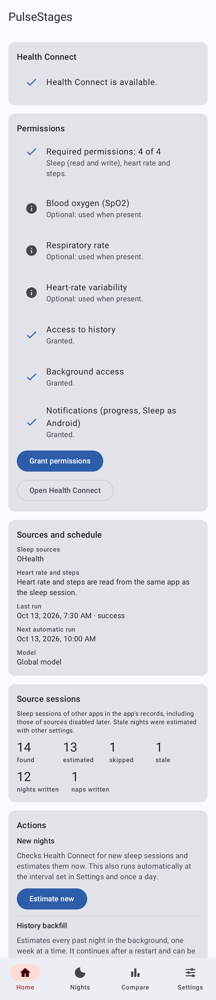
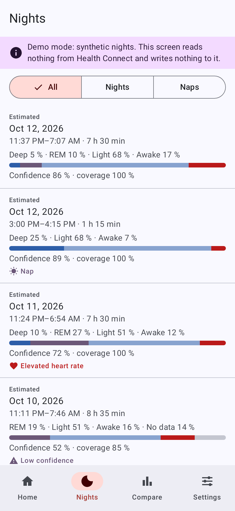
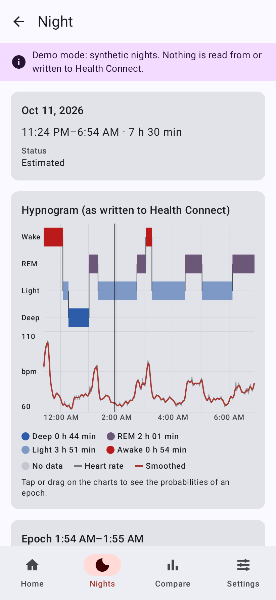
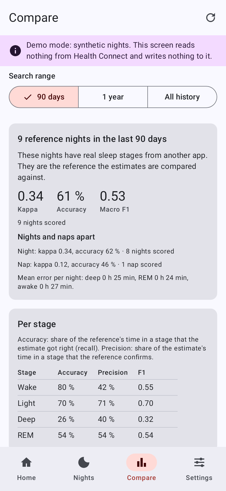
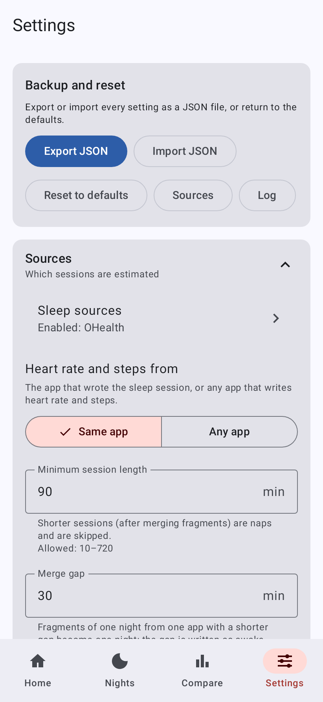
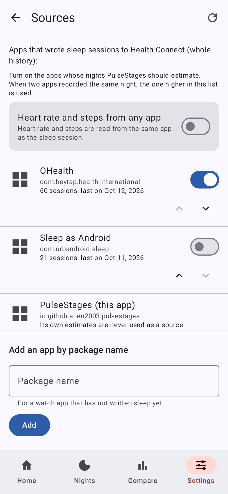

<p align="center"></p>

# PulseStages

PulseStages is an Android app. It estimates sleep stages (awake, light, deep, REM) from the heart rate that a watch
writes to Health Connect, then writes them back to Health Connect as a separate sleep session labelled as an
estimate.

License: [WTFPL](LICENSE). Do whatever you want with the code.

Ready-made APKs are on the [Releases page](https://github.com/alien2003/PulseStages/releases).
[Downloads](#downloads) explains the release and the debug build.

- [What it does](#what-it-does)
- [How accurate it is](#how-accurate-it-is)
- [Screenshots](#screenshots)
- [Build](#build)
- [Install on the phone from WSL](#install-on-the-phone-from-wsl)
- [First run and permissions](#first-run-and-permissions)
- [Sleep sources and priority](#sleep-sources-and-priority)
- [What Sleep as Android and other readers will see](#what-sleep-as-android-and-other-readers-will-see)
- [recordingMethod and device](#recordingmethod-and-device)
- [Idempotency, versions and stale nights](#idempotency-versions-and-stale-nights)
- [Automatic runs](#automatic-runs)
- [Deleting your data](#deleting-your-data)
- [Settings, log, CSV export, Compare and calibration](#settings-log-csv-export-compare-and-calibration)
- [Training, validation and dataset attribution](#training-validation-and-dataset-attribution)
- [GitHub: CI and releases](#github-ci-and-releases)
- [Project structure](#project-structure)
- [Known limitations and ideas for the next version](#known-limitations-and-ideas-for-the-next-version)

## What it does

The app was built for an OPPO Watch X3 paired with OHealth (`com.heytap.health.international`). OHealth writes
`SleepSessionRecord`s to Health Connect with no stages, only a start and an end. It also writes a `HeartRateRecord`
sample about every 2 minutes.

For every night, PulseStages does the following:

1. It reads the sleep session and the heart rate around it from Health Connect: 30 minutes before and after, plus
   steps. It also reads SpO2, respiratory rate and HRV (RMSSD) when they exist and you allowed them.
2. It estimates AWAKE / LIGHT / DEEP / REM for every one-minute epoch. The default estimator is HYBRID: a trained
   classifier whose output is decoded with explicit bout durations. HMM and RULES can be chosen in Settings.
3. It writes **its own** `SleepSessionRecord` with the stages. That record:
   - has the same start and end as the source session;
   - is titled "Sleep stages from heart rate (estimate)" (translated into Russian on a phone set to Russian);
   - carries the algorithm version and a hash of every parameter in its `notes`, so the night can be recomputed
     later.

Rules it follows:

- It never modifies or deletes data of other apps. Health Connect only lets an app delete its own records, and
  PulseStages deletes only its own, by `clientRecordId`.
- It has no `INTERNET` permission. The manifest removes it even if a library asks for it, and `MergedManifestTest`
  checks the merged debug and release manifests.
- Sources are selectable. OHealth is the default, and any app that writes sleep sessions to Health Connect can be
  enabled. New nights are processed automatically. The whole history is processed on request (backfill).
- It runs on Android 9 and later (minSdk 28; targetSdk 36; compileSdk 37). Health Connect is part of Android 14+. On
  Android 9–13 it is the separate Health Connect app from Google Play.

## How accurate it is

The output is an estimate, not a measurement. Do not use it for medical decisions.

The estimators were validated leave-one-subject-out on the 31 polysomnography (PSG) nights of PhysioNet sleep-accel
(Walch et al.). The heart rate was thinned to one value every 2 minutes, as OHealth delivers it, and the worse of two
emulations was reported.

For the default HYBRID estimator (worse of the two emulations):

- Cohen's κ is 0.339 ± 0.169 (mean ± sd over subjects; 0.348 on the other emulation). Accuracy is 0.612 and
  macro-F1 is 0.522.
- The mean absolute error per night is about 33 min for DEEP, 41 min for REM and 19 min for AWAKE. The predicted
  stage shares match PSG closely (about 13–15 % DEEP, 20–24 % REM, 57–59 % LIGHT vs 14 / 23 / 57 % in PSG), thanks to
  the pre-registered proportion-matching correction (ALGORITHM.md §13.10).
- For comparison, the HMM scores κ 0.070 and RULES 0.076.
- Averaged over four training seeds, the setup without the proportion correction scores κ 0.317. Treat about 0.32–0.34
  as the expected figure.

That is "fair" agreement; ALGORITHM.md §14 compares it with published results. It varies strongly between people:
per-subject κ ranges from about −0.03 to 0.65, and single nights can be far off.

The training subjects were healthy adults wearing an Apple Watch (the Walch subjects were 29 ± 9 years old). An OPPO
watch, older people, sleep disorders or heart medication may behave differently.

These numbers come from [ALGORITHM.md §13.1](ALGORITHM.md#131-headline-walch-psg-ohealth-like-session-window). That
section is the authoritative source; if it differs from this paragraph, it wins. Limitations are in
[§16](ALGORITHM.md#16-limitations).

### Naps

PulseStages can estimate daytime naps if you lower "Minimum session length" (`minSessionMin`, 90 min by default) to
30 min, but treat the result as a rough sketch, not a stage breakdown. No public dataset has labelled naps, so it was
tested on the first 30–180 minutes of the 31 lab nights: about half of the 30-second epochs matched polysomnography,
and for a 30-minute nap the result was no better than calling the whole nap light sleep. Sessions shorter than 3 hours
now get their own stage correction, which removes most of the false REM sleep the night-trained model put into naps.
Sessions of 3 hours or more are decoded exactly as before. With the default settings, short nights of 90 minutes to
3 hours also get the nap correction. The planned test covered sessions up to 2 hours; a later check at 150 and 170
minutes found no clear improvement there (the correction then shows too little REM). In the planned test about 4 in
5 naps were marked low-confidence, mostly because their stage shares looked implausible for a night. Sessions shorter
than 3 hours no longer get that check, so now only a too-small heart-rate range marks a nap (about 1 in 3 to 2 in 5 of
the tested naps of up to 2 hours, and 3 in 5 to 3 in 4 of the 30-minute ones). The estimate itself is unchanged, so an
unmarked nap is still only a rough sketch. Details:
[ALGORITHM.md §13.11](ALGORITHM.md#1311-daytime-naps-nap-proxies-and-a-short-session-bias-pre-registered-adopted).

**Nights and naps are two processing modes.** One setting decides which is which: Settings → **Naps** → "Nap
threshold" (`napMode.maxSessionMin`, 180 min). A session shorter than that is a nap, a longer one a night; 0 turns
naps off. Sessions shorter than "Minimum session length" of the sources are still ignored altogether. A nap:

- is never compared with your heart-rate baseline and never counts for it (no "elevated heart rate" for naps);
- gets no stage-share check unless "Check the stage shares of naps" is on;
- is estimated with "Estimator for naps" (HYBRID), and with the nap values of the minimum bouts, the uncertain-epoch
  settings and the hybrid decoder. Each of these is empty by default, which means "same as nights";
- is decoded with a nap model when the model bundle has one. The bundled model has none yet, so naps are decoded by
  the night model with the short-session correction above, exactly as before the two modes;
- is written as "Written for a nap" says: **Stages** (like a night, the default), **Asleep / awake** (only AWAKE and
  SLEEPING in Health Connect; the app still shows its stage estimate) or **Nothing** (not estimated, nothing written;
  an earlier output of the nap is removed when it is processed again);
- is left out of the calibration on reference nights and of the unsupervised adaptation.

The Nights tab marks naps with a **Nap** badge and can show all sessions, only nights or only naps. The night detail
says whether a session was processed as a night or a nap and, for a nap, that its stages are rough. Home counts
written nights and naps apart. Details: [ALGORITHM.md §18](ALGORITHM.md#18-night-and-nap-modes-napmode).

## Screenshots

These screenshots contain no real health data. They are rendered on the JVM by `ScreenshotsTest` (Robolectric native
graphics, light theme with the app's own palette, a 411 × 891 dp phone): the Nights list, the night detail and Compare
show the debug build's demo data (synthetic nights from core-algo's generator, estimated by the real algorithm with
the bundled model), and Home, Settings and Sources show fixed example states. To render them again after a change:
`./gradlew :app:testDebugUnitTest --tests '*ScreenshotsTest' -PrecordScreenshots`.
[docs/SCREENSHOTS.md](docs/SCREENSHOTS.md) explains this and how to take screenshots on a phone: in a debug build,
Settings → **Debug build** → **Demo mode** switches these screens to the demo data at once (the app has a single
launcher icon in every build).

| Home | Nights | Night detail |
|---|---|---|
|  |  |  |

| Compare | Settings | Sources |
|---|---|---|
|  |  |  |

## Build

### Prerequisites

- Linux, or WSL 2 (Ubuntu) on Windows. Keep the project in the Linux file system (`~/…`), not under `/mnt/c`.
- [mise](https://mise.jdx.dev/) installed.

Everything else lives inside the project folder. Nothing is installed system-wide.

- `.mise.toml` provides:
  - Temurin 17 and Python 3.12 (with the venv `tools/train/.venv`);
  - `ANDROID_HOME` and `ANDROID_SDK_ROOT` set to `.tooling/android-sdk`, and `GRADLE_USER_HOME` set to
    `.tooling/gradle`;
  - `ADB_WIN`, and `PATH` entries for `sdkmanager` and `platform-tools`.
- The Android SDK lives in `.tooling/android-sdk`. It is installed from Google's command-line tools 23.0 with
  `sdkmanager`.
- Gradle runs only through the wrapper `./gradlew` (Gradle 9.8.1).
- `.tooling/` and `local.properties` are git-ignored.

### One-time setup

```sh
cd ~/PulseStages
mise trust          # only if mise asks to trust the project's .mise.toml
mise install        # Temurin 17 and Python 3.12

# Android command-line tools 23.0 (official zip; SHA-1 from Google's repository2-3.xml)
mkdir -p .tooling/dl .tooling/android-sdk/cmdline-tools
curl -fL -o .tooling/dl/cmdline.zip \
  https://dl.google.com/android/repository/commandlinetools-linux-16111833_latest.zip
echo "e025545c62a8e64c7559119566a569fb1dec5f60  .tooling/dl/cmdline.zip" | sha1sum -c -
unzip -q .tooling/dl/cmdline.zip -d .tooling/dl/extract
mv .tooling/dl/extract/cmdline-tools .tooling/android-sdk/cmdline-tools/latest

# SDK packages (as listed in PLAN.md)
yes | mise exec -- sdkmanager --licenses
mise exec -- sdkmanager "platform-tools" "platforms;android-36" "platforms;android-37.0" \
  "build-tools;36.0.0" "build-tools;37.0.0"
```

The project was set up with cmdline-tools 23.0, platform-tools 37.0.1, platforms `android-36` and `android-37.0`,
and build-tools 36.0.0 and 37.0.0 (PLAN.md §1). compileSdk 37 uses the minor-versioned platform `android-37.0`. AGP
9.4 uses build-tools 36.0.0 by default. The platform-tools are not needed for installing on the phone (see below).
The `unzip` step needs the `unzip` tool.

### Build, test and lint

```sh
mise exec -- ./gradlew assembleDebug test ktlintCheck detekt
```

The debug APK is written to `app/build/outputs/apk/debug/app-debug.apk`.

`./gradlew assembleRelease` writes `app/build/outputs/apk/release/app-release-unsigned.apk`. To get a signed release
build, see [Signing secrets](#signing-secrets).

Local builds use versionName `0.1.0-dev` and versionCode 1. To override them, pass
`-PversionName=1.2.3 -PversionCode=1020399` (the values the release workflow derives from the tag `v1.2.3`).

## Install on the phone from WSL

The phone is connected to Windows, so the Linux `adb` in `.tooling/android-sdk/platform-tools` cannot see it. Use the
Windows adb instead.

`.mise.toml` sets `ADB_WIN=adb.exe`, the Windows adb found on `PATH` through WSL interop. If it is not on your `PATH`,
set `ADB_WIN` to a path such as `/mnt/c/Users/<you>/AppData/Local/Android/Sdk/platform-tools/adb.exe`.

Inside a shell with the project environment (`mise exec -- bash`), install the APK and follow the log:

```sh
"$ADB_WIN" install -r "$(wslpath -w app/build/outputs/apk/debug/app-debug.apk)"
"$ADB_WIN" logcat -s PulseStages:V
```

**Do not use `./gradlew installDebug`.** It uses the Linux adb, which cannot see the phone.

The app's internal log is mirrored to logcat with the tag `PulseStages`, at or above the level set in Settings →
Debugging → Log level (default INFO).

A release APK cannot be installed over a debug APK, because they are signed with different keys. You must uninstall
first, which revokes all Health Connect permissions (see [Deleting your data](#deleting-your-data)).

## First run and permissions

Open the app. The **Home** tab shows the state of Health Connect and of every permission.

### Health Connect itself

- **Android 14 and later.** Health Connect is part of the system and is no longer on the home screen. Google gives
  the path as Settings → Security and privacy → Privacy controls → Health Connect. Variants are "Security & Privacy →
  Privacy → Health Connect" and "… → Permission manager → Health Connect". You can also search Settings for
  "Health Connect".
- **Android 9–13.** Health Connect is an app from Google Play. "Install or update Health Connect" opens its Play
  page.
- **Work profiles.** Health Connect does not work in work profiles.
- **From PulseStages.** "Open Health Connect" opens PulseStages' own permission page in Health Connect on Android 14+,
  or Health Connect's settings on older versions.

### Permissions

| Permission | Kind | Without it |
|---|---|---|
| `READ_SLEEP`, `WRITE_SLEEP`, `READ_HEART_RATE`, `READ_STEPS` | required ("Grant permissions") | Nothing can be estimated. Home shows "Required permissions: n of 4". |
| `READ_OXYGEN_SATURATION`, `READ_RESPIRATORY_RATE`, `READ_HEART_RATE_VARIABILITY` | optional | Not used. Home shows "Optional: used when present." |
| `READ_HEALTH_DATA_HISTORY` | for the backfill ("Allow history") | History is limited (details below). |
| `READ_HEALTH_DATA_IN_BACKGROUND` | for automatic runs ("Allow background") | Background runs are blocked (details below). |
| Notifications (Android 13+) | progress of backfill / recompute ("Allow notifications") | "Not allowed: the backfill runs without a progress notification." |

"Grant permissions" asks for everything still missing in one Health Connect dialog. The two special permissions are
only requested when the installed Health Connect supports them. If it does not, Home says "This Health Connect
version cannot grant it."

**Without history access.** Health Connect returns other apps' data only from 30 days before the app's first
permission grant ([read data](https://developer.android.com/health-and-fitness/health-connect/read-data)). The app
shows this as follows:

- Home shows "Not granted: Health Connect returns no data older than 30 days before PulseStages was first given
  access, so the history backfill is limited."
- A finished backfill reports "History was limited to 30 days before PulseStages was first given access (no access to
  history)."
- The Sources screen scans the last 90 days instead of the whole history.

**Without background access.** In the background, Health Connect would silently return only PulseStages' own data.
The app checks the permission and refuses to read instead of producing empty nights:

- Home shows "Not granted: new nights are only processed while the app is open."
- Hourly and daily runs that start while the app is not in the foreground read nothing. "Last run" then shows "no
  background access".
- Runs that you start in the app ("Estimate new", backfill, recompute) run as a foreground service with a
  notification.

**If you cancel the permission dialog twice,** Health Connect stops showing it. Home then says "Health Connect no
longer shows the permission dialog. Open its settings to grant the permissions." and offers "Open Health Connect
settings".

### Privacy screen

The rationale / privacy screen ("PulseStages and your health data") lists what is read and written and how to delete
it. You can open it in two ways:

- from Home → "How PulseStages uses your data";
- from the privacy-policy link on Health Connect's permission screen.

Health Connect finds this screen through `androidx.health.ACTION_SHOW_PERMISSIONS_RATIONALE` up to Android 13. On
Android 14+ it uses an `activity-alias` with `android.intent.action.VIEW_PERMISSION_USAGE` and
`android.intent.category.HEALTH_PERMISSIONS`. Without that alias, Android 14+ grants no health permissions.

## Sleep sources and priority

### The Sources screen (Settings → "Sleep sources")

- **What it lists.** Every app that wrote sleep sessions to Health Connect: in the last 90 days, or in the whole
  history with history access. Each entry has the app's icon and name, the number of sessions, the date of the last
  one and a switch.
- **Default.** Only OHealth (`com.heytap.health.international`) is enabled.
- **Priority.** The order of the list is the priority (up / down buttons). If two enabled apps recorded the same night
  (overlap of more than half of the shorter session), the higher one is used. The other is skipped as a lower-priority
  duplicate. This holds also when the higher-priority app recorded the night with its own sleep stages: that night
  needs no estimate, so PulseStages writes nothing for it, and an estimate it wrote earlier for the lower-priority
  app's session is removed (unless "Existing sessions" is "Never overwrite"). If that staged session is deleted later,
  the next run estimates the lower-priority session again. Under "Recompute everything" sessions with stages are
  estimated too, so the priority decides between the two like for any other night.
- **A piece of a night is not the night.** A session that lies mostly inside a longer session of another app but covers
  at most half of it (say 40 minutes one watch recorded of a night another app recorded completely) never replaces
  that night, whatever the priority. It is skipped as a duplicate of it. This applies only when that longer session
  is used itself: if it lost to a night of a higher-priority app, the piece is weighed by priority like any night.
- **Manual package.** "Add an app by package name" adds a watch app that has not written sleep yet.
- **Heart rate and steps.** "Heart rate and steps from any app" is the setting `hrSources`. The default `SAME_AS_SLEEP`
  reads heart rate and steps only from the app that wrote the sleep session. `ANY` reads them from every app.
- **Own sessions.** PulseStages' own sessions are never used as a source.

### Which source sessions become nights

- A session that already has real stages (any stage other than UNKNOWN or SLEEPING) is skipped. The exception is the
  overwrite policy "Recompute everything".
- Fragments of one night from one app with a gap shorter than `mergeGapMin` (30 min) are merged into one night. The
  gap is written as AWAKE.
- A merged session shorter than `minSessionMin` (90 min) is ignored (it is not processed at all).
- Every other merged session is processed as a nap if it is shorter than the nap threshold `napMode.maxSessionMin`
  (180 min, Settings → Naps), otherwise as a night (see [Naps](#naps)). With the default 90 min this means sessions of
  90–180 min are naps. Lower `minSessionMin` (Settings → Sources), for example to 30 min, to estimate shorter naps too.
  A nap:
  - does not count for the heart-rate baseline and is never marked "elevated heart rate";
  - gets no sanity check of the stage shares (unless `napMode.post.checkProportions`), so a nap without deep sleep is
    not flagged as implausible;
  - uses the short-session correction of the bundled model, or the bundle's nap model when it has one;
  - is written with all stages, as asleep / awake only, or not at all (`napMode.outputPolicy`).
- A nap that ends less than `mergeGapMin` before the night is merged into the night (the gap is AWAKE).

### Health Connect's own "Data sources and priority"

The path is Health Connect → Permissions and data → Manage data → Data sources and priority
([Google help](https://support.google.com/android/answer/12990553)). What that list does
([aggregate data](https://developer.android.com/health-and-fitness/health-connect/aggregate-data)):

- Health Connect de-duplicates only the Activity and Sleep data types, and only inside `aggregate()`. There it keeps
  the data of the app with the highest priority.
- `readRecords()` returns the sessions of every app, overlapping ones included. Apps that list sessions must
  de-duplicate them themselves.
- An app removed from the list still writes data, but its data no longer counts in the totals.

**Recommendation:** for Sleep, move PulseStages above OHealth.

- Effect: sleep totals in Health Connect, and in any reader that uses `aggregate()`, are then taken from PulseStages'
  staged session instead of OHealth's session without stages.
- What it does not change: the session readers that call `readRecords()` see, and the sessions PulseStages reads
  itself.

## What Sleep as Android and other readers will see

### Sleep as Android imports

Sleep as Android can import third-party sleep from Health Connect
([its docs](https://sleep.urbandroid.org/docs/services/health_connect.html)):

- turn it on in Settings → Services → Health Connect (marked beta) and grant the permissions;
- tap Sync once; after that it syncs in the background.

### Two sessions for every night

For every estimated night, Health Connect contains two overlapping sleep sessions:

- OHealth's session, without stages;
- PulseStages' session, with stages, titled from the template (default "Sleep stages from heart rate (estimate)").

**Sleep as Android does not document how it handles two overlapping sessions from different Health Connect apps.** It
documents duplicate filtering only for Samsung Health and Google Fit. This has not been verified on a device yet. In
practice:

- After the first Sleep as Android sync, check its list for that night.
- If both sessions appear, delete the stage-less one inside Sleep as Android. That removes only Sleep as Android's
  copy: Health Connect lets an app delete only its own records, so OHealth's data stays. Whether a later sync imports
  it again is not documented.
- If Sleep as Android shows awakenings badly, turn on Settings → Written sessions → "Write awake as light sleep"
  (`awakeAsLight`). This changes the written data and the params hash.
- The stages can always be viewed in PulseStages' Nights tab.

### Stage mapping

These are the stages PulseStages writes, using only `SleepSessionRecord.STAGE_TYPE_*` constants:

| PulseStages | Health Connect stage type |
|---|---|
| AWAKE | `STAGE_TYPE_AWAKE` (1); `STAGE_TYPE_LIGHT` with `awakeAsLight` |
| LIGHT | `STAGE_TYPE_LIGHT` (4) |
| DEEP | `STAGE_TYPE_DEEP` (5) |
| REM | `STAGE_TYPE_REM` (6) |
| no data: heart-rate gap longer than `maxInterpGapMin` (10 min) | `STAGE_TYPE_UNKNOWN` (0) with the default `gapPolicy` UNKNOWN; LIGHT or the neighbouring stage with `gapPolicy` LIGHT / NEAREST |
| gap between merged fragments | AWAKE |

A nap written with "Written for a nap" = **Asleep / awake** (`napMode.outputPolicy` SLEEP_WAKE) gets only
`STAGE_TYPE_AWAKE` (1) and `STAGE_TYPE_SLEEPING` (2): LIGHT, DEEP, REM and no-data spans are SLEEPING, and with
`awakeAsLight` AWAKE is SLEEPING too. Nights always get the table above.

Rules for the written stages:

- They cover the session exactly, with no gaps or overlaps.
- They are sorted, and each is at least one epoch (60 s) long.
- Adjacent equal stages are merged.

Sleep as Android's hypnogram has Awake, REM, Light and Deep levels. How it maps `STAGE_TYPE_UNKNOWN` on import is not
documented.

### Title and notes

**Title.** It comes from Settings → Written sessions → "Session title" (`titleTemplate`), with the placeholders
`{estimator}`, `{version}` and `{confidence}` (night confidence in %). Leave it empty for the localized default,
which follows the phone's language at write time. This is a deliberate choice: the default of the specification,
in Russian, is what a phone set to Russian writes, and other languages get its English translation, like
every other text of the app. A night rewritten after a change of the phone's language gets the title in the new
language; to keep one title whatever the language, type it into the field. The title is not part of the params hash,
so changing it does not make nights stale.

**Notes.** They are compact JSON, for example:

```json
{"algo":"HYBRID","mode":"NIGHT","version":1,"paramsHash":"…","coverage":0.93,"confidence":0.61,"sourceUuids":["…"],"hrSamples":231,"calibrated":false}
```

| Field | Meaning |
|---|---|
| `algo` | estimator used |
| `mode` | `NIGHT` or `NAP`: the processing mode of the session (see [Naps](#naps)) |
| `version` | `ALGO_VERSION` |
| `paramsHash` | see [Idempotency](#idempotency-versions-and-stale-nights) |
| `coverage` | share of epochs with heart rate |
| `confidence` | night confidence |
| `sourceUuids` | Health Connect ids of the source sessions |
| `hrSamples` | heart-rate samples in the session |
| `calibrated` | whether the stage proportions were calibrated (`calibrateProportions`) |

## recordingMethod and device

### What is written

PulseStages writes its records with:

```kotlin
Metadata.unknownRecordingMethod(
    clientRecordId = …, clientRecordVersion = …,
    device = Device(type = Device.TYPE_PHONE, manufacturer = Build.MANUFACTURER, model = Build.MODEL),
)
```

The code is `HcRecordMapper.toRecord`, with the device from `PlatformInfo.CURRENT` in `HealthConnectRepository`
(module `:data-hc`).

### What the official documentation says

The
[Metadata reference](https://developer.android.com/reference/kotlin/androidx/health/connect/client/records/metadata/Metadata)
defines four recording methods:

| Recording method | Official definition |
|---|---|
| `RECORDING_METHOD_ACTIVELY_RECORDED` | "Data actively recorded by the user" |
| `RECORDING_METHOD_AUTOMATICALLY_RECORDED` | "For data recorded passively by a device without user explicitly initiating the recording, or whenever it cannot be determined" |
| `RECORDING_METHOD_MANUAL_ENTRY` | "Data manually entered by the user" |
| `RECORDING_METHOD_UNKNOWN` | "Unknown recording method" |

A device is mandatory for actively and automatically recorded data, and optional for manual entries and the unknown
method. The [write-data guide](https://developer.android.com/health-and-fitness/health-connect/write-data) says:
"When writing data that has been imported or derived from another source, you are expected to correctly attribute its
origin and source device metadata." No recording method exists for data computed by an algorithm.

### Why UNKNOWN and the phone

- `AUTOMATICALLY_RECORDED` with the watch as the device would tell readers that a watch measured these stages. No
  sensor measured them: the phone inferred them from heart rate.
- The "cannot be determined" clause does not fit either. It is known exactly how the record was produced.
- `UNKNOWN` makes no claim that a sensor recorded the stages.
- The device is the phone that computed and wrote the record.

The origin is still attributed:

- `notes.sourceUuids` lists the source sessions, whose own metadata name OHealth and its device;
- the title says "estimate";
- `notes` carry the algorithm version and the params hash.

A reader that filters by recording method or device type may treat these records differently from watch data. This
has not been tested with readers.

## Idempotency, versions and stale nights

### Record keys

- **`clientRecordId`** is `"ps:" + SHA-256 hex` of the source session uuids, de-duplicated, sorted and joined with
  `,` (`NightKeys.clientRecordId`). The same source sessions always give the same key, so one night has one output.
- **`clientRecordVersion`** is `ALGO_VERSION · 1000 + recompute count`, so 1000, 1001, … while `ALGO_VERSION` is 1.
  It is never below the version already stored in Health Connect + 1.

### Upsert, checked in the AOSP sources

This is documented in PLAN.md §4 (AOSP HealthFitness `RecordHelper` / `TransactionManager`, identical in
android14…android17):

- On Android 14+, inserting a record with a known `clientRecordId` updates the stored row in place when the new
  version is ≥ the stored one.
- A lower version is silently ignored.
- The documentation itself only promises that the higher version wins.

PulseStages reads every write back and compares the version and the number of stages (`VerifiedUpsert`). If the
read-back does not match, it deletes its record by `clientRecordId`, inserts it again and verifies once more. A
mismatch happens when a higher stale version is stored, or when the Health Connect app on Android 9–13 ignored the
insert. That app is closed source, so only the documented "higher version wins" applies there.

### The ledger

A Room database keeps one row per night in `estimated_nights`, linked to all its source uuids in `night_sources`, plus
`source_sessions`. Each night row holds the `clientRecordId`, algorithm version, params hash, coverage, confidence,
status, the processing mode (night or nap; whether a nap was written as asleep / awake only) and timestamps. The
schema is versioned and migrated in place (version 2 added the mode; rows of sessions shorter than 180 min became
naps); there is no destructive fallback.

This ledger handles the cases where source sessions change:

- **New fragment.** A fragment that joins a night gives a new set of uuids, and with it a new `clientRecordId`. The
  old output is deleted (only our own record) and marked "Replaced".
- **Deleted sources.** If every source session of a night was deleted in Health Connect, our record is deleted and
  the night shows "Source deleted". If only some were deleted, the night is rebuilt from the rest.
- **Reinstall or cleared data.** The ledger is gone in that case (backups are off). Our earlier records of the same
  night are found by reading our own data and deleted, so a night never ends up with two outputs.

### Params hash and stale nights

**`paramsHash`** is the SHA-256 of:

- all algorithm parameters;
- the bundled model's fingerprint;
- the personal model's fingerprint;
- the input and output options that change the result (`hrSources`, which optional channels are read,
  `awakeAsLight`).

**Stale** means that a written night was produced with another algorithm version or another params hash than the
current settings. Stale nights are shown in these places:

- the "Stale" marker in Nights;
- the "stale" counter on Home;
- Home → "Recompute stale nights";
- the Recompute offer that Settings shows after a change.

### Overwrite policy

Overwrite policy is Settings → Written sessions → "Existing sessions" (`overwritePolicy`):

| Option | Behaviour |
|---|---|
| Skip up-to-date nights (`SKIP_SAME_VERSION`, default) | Nights with the current version and hash are skipped. Stale nights are marked, never recomputed silently, and recomputed only when you ask. |
| Recompute everything (`RECOMPUTE_ALL`) | Every run estimates the nights it reads again and rewrites them. Source sessions that already have stages are included. |
| Never overwrite (`NEVER`) | An existing PulseStages session is never rewritten, not even by Recompute. Only nights without a session are estimated. |

If a source session's boundaries change, the night is recomputed under every policy except `NEVER`.

## Automatic runs

All runs use WorkManager.

- **Hourly check.** It runs every `periodicHours` (default 1), only when the battery is not low
  (`runOnlyWhenNotLowBattery`, default on). It asks the Changes API for new, changed or deleted sleep sessions of the
  enabled sources. The changes token is stored in DataStore.
  - It re-reads the last 7 days instead in these cases: on the first run, after the sources changed, or when the token
    expired or was not advanced for 25 days.
  - The re-read reaches back further, to the last successful sync, but at most 30 days.
- **Daily run.** It runs at "Daily run" (`dailyTimeMinutes`, default 09:00 local time), with the same battery
  constraint. The time is approximate, because Android may delay background work.
- **"Estimate new"** on Home runs the same check immediately, as expedited work with a notification.
- **Retries.** After each complete run, recent nights that could not be estimated yet are tried again, because their
  heart rate may arrive after the session.
- **"Backfill history"** processes the whole history, oldest first, in 7-day windows:
  - only the windows read sessions: the start of the range is found with one Health Connect request for a single
    record (the oldest session);
  - it shows progress ("Week x of y") and can be cancelled;
  - it continues after a restart ("Resume backfill");
  - its range is "History depth" (`backfillDays`; 0 = all available history);
  - it writes nights that you deleted before you started it again, but not a night you delete while it runs.
- **Recompute.** Home → "Recompute all" (with confirmation) or "Recompute stale nights", or "Recompute" on a single
  night. A recompute also writes a night you deleted before asking for it again, but not one you delete while it is
  pending or running.
- **Errors.** Health Connect quota errors and transient errors are retried with exponential backoff. WorkManager's
  backoff starts at 30 s and doubles up to 5 h. A failure on one night is logged and does not stop the others.

## Deleting your data

- **All sessions.** Home → "Delete my sessions from Health Connect" asks for confirmation, then:
  - deletes by `clientRecordId` every session in the ledger, plus any PulseStages session found by reading its own
    data (for example from before a reinstall);
  - cancels a running backfill and every recompute asked for before (a running one stops before its next night), so
    neither can write the erased nights again;
  - marks the nights "Deleted by you".

  Automatic runs do not write deleted nights again; a backfill or a recompute started afterwards does.
- **One night.** Nights → a night → "Delete my session" works the same way for that night.
- **In Health Connect.** Use Health Connect → Permissions and data → App permissions → PulseStages → Delete app data,
  choose a period, then Next → Delete ([Google help](https://support.google.com/android/answer/12201232)). The same
  page can revoke every permission.
- **Uninstalling** PulseStages deletes its private storage (ledger, settings, log) and revokes its permissions. **It
  does not delete its sessions from Health Connect.** Google's help lists an app that is "uninstalled but still has
  data stored in Health Connect" under Inactive apps, in Health Connect → Permissions and data → App permissions
  ([Google help](https://support.google.com/android/answer/12201872)). Delete the sessions before uninstalling.
- **OHealth's data** is never touched by any of these.

## Settings, log, CSV export, Compare and calibration

### Settings

- **The Settings tab** holds every parameter, grouped, each with a hint. On the unfolded screen they are shown in two
  columns. The groups are:
  - sources, schedule, written sessions;
  - algorithm, preprocessing, features;
  - naps (the nap threshold, what is written for a nap, the nap estimator and the nap values of post-processing and
    of the hybrid decoder; empty values mean "same as nights");
  - rules, HMM emissions / transitions / priors, hybrid;
  - post-processing, personalization, debugging.
- **"Export JSON"** saves every setting, defaults included, through the system file picker (suggested name
  `pulsestages-settings.json`).
- **Stored settings** keep only the values you changed. The defaults that come from the open-dataset validation
  (estimator, hybrid decoder settings, ...) therefore follow app updates for everything you never changed; a value
  you changed stays as you set it.
- **"Import JSON"** validates the file first. If anything is wrong, nothing changes and every problem is listed.
  Unknown keys are ignored and missing keys take their defaults. This includes the three nap thresholds of earlier
  versions (`features.baselineMinSessionMin`, `hybrid.shortSessionMaxMin`, `post.proportionsMinSessionMin`), which
  the one `napMode.maxSessionMin` replaced.
- **"Reset to defaults"** resets everything; "Reset to physiology table" resets only the HMM emissions.
- **"Versions and licences"**, the last card, shows the app version, the algorithm version, the id of the bundled
  model, the licence and the dataset attribution notice (see
  [Training, validation and dataset attribution](#training-validation-and-dataset-attribution)).
- **After changing an algorithm parameter,** Settings says how many nights are now stale and offers to recompute them.
- **Log** (Settings → Log) shows the internal log with a filter by level. "Share log" sends `pulsestages-log.txt`
  through the share sheet.

### Night detail

The detail screen of a night shows:

- whether the session was processed as a night or a nap, and for a nap that its stages are rough (and, with
  "Asleep / awake", that only sleep and wake were written);
- the hypnogram as written;
- the heart-rate curve;
- the probabilities and features of an epoch when you tap or drag on the charts;
- the warnings.

Its actions:

- "Compare with RULES" shows how far the simple threshold estimator agrees (kappa, accuracy).
- "Export CSV" saves `pulsestages-yyyyMMdd-HHmm.csv` with the columns
  `epoch,start_ms,has_data,hr_raw,hr_smooth,<features…>,p_awake,p_light,p_deep,p_rem,stage,mode`.

The curves, probabilities and CSV come from a fresh estimate with the current settings. Nothing is written by this,
and the result can differ from what was written.

### Compare and calibration

**Reference nights** are sessions with real stages that another app wrote to Health Connect, for example another
watch, a ring or Sleep as Android. OHealth's stage-less sessions cannot be references.

The Compare tab:

- searches 90 days, 1 year or the whole history;
- estimates the same nights from heart rate;
- shows kappa, accuracy, macro F1, the mean error in minutes, per-stage accuracy / precision / F1, a confusion matrix
  and a per-night list; when the reference sessions include naps, kappa and accuracy of the nights and of the naps
  apart, and the list marks the naps.

**"Calibrate"** fits a personal model on the reference nights (details in
[ALGORITHM.md §10](ALGORITHM.md#10-personalization-personal)):

- It adjusts the classifier's per-stage offsets for HYBRID and the emission means for the HMM.
- It uses reference nights only; reference naps are left out.
- The latest 30 % of the nights are held out, and Compare shows kappa before → after on them.
- The model is stored in Room and used for every later estimate. Earlier nights become stale.
- It needs Settings → Personalization → "Personal model" (on by default).

**"Reset to global model"** switches the personal model off.

**Unsupervised adaptation.** Without reference nights, the HMM emissions are adapted to your nights every 30 new nights
(naps neither take part nor count). This runs only when the HMM is actually used: estimator HMM, or HYBRID falling back
to it. With the default HYBRID estimator it does not run.

## Training, validation and dataset attribution

- **Code.** Python in [tools/train/](tools/train/README.md) downloads the datasets, emulates OHealth's 2-minute heart
  rate, trains the hybrid model and runs the leave-one-subject-out validation. Features and decoders are always
  computed by `:algo-cli`, the same Kotlin code that runs on the phone.
- **Method and numbers.** The protocol is in [ALGORITHM.md](ALGORITHM.md) §12, the numbers in §13 and the retraining
  commands in §17.
- **Tests.** `mise exec -- pip install -r tools/train/requirements.txt`, then
  `mise exec -- python -I -m pytest tools/train/tests -q`. They use synthetic data only.
- **Datasets** ([DATASETS.md](tools/train/DATASETS.md)):
  - PhysioNet **sleep-accel 1.0.0** (Walch et al. 2019): PSG labels, the headline validation;
  - PhysioNet **BIDSleep 1.0.1** (Song et al. 2026): EEG-headband labels, extra training data and a second
    validation set;
  - both are open access under ODC-By 1.0;
  - DREAMT is not used, because its access is restricted.
- **Raw data** are never committed.

The bundled model `app/src/main/assets/models/hybrid_model.json` is a produced work of both datasets. Attribution
notice:

> Contains information from *Motion and heart rate from a wrist-worn wearable and labeled sleep from
> polysomnography* (https://physionet.org/content/sleep-accel/1.0.0/) and from *BIDSleep: A Multi-Night
> Instantaneous Heart Rate and Accelerometry Dataset with EEG Sleep Stage Labels*
> (https://physionet.org/content/bidsleep-dataset/1.0.1/), which are made available under the ODC Attribution
> License (https://opendatacommons.org/licenses/by/1-0/).

Citations:

- Walch O. (2019), sleep-accel v1.0.0, PhysioNet, https://doi.org/10.13026/hmhs-py35
- Walch O, Huang Y, Forger D, Goldstein C. Sleep 42(12):zsz180 (2019), https://doi.org/10.1093/sleep/zsz180
- Song T, Zhang Y, Zhou Z, Dutta J. (2026), BIDSleep v1.0.1, PhysioNet, https://doi.org/10.13026/rees-1092
- Song TA et al. IEEE TBME 73(4):1596–1608 (2026), https://doi.org/10.1109/TBME.2025.3612158
- Pollard T et al. PhysioNet as a global platform for biomedical research, Nature Health (2026),
  https://doi.org/10.1038/s44360-026-00096-z

## GitHub: CI and releases

### Downloads

Ready-made APKs are on the [Releases page](https://github.com/alien2003/PulseStages/releases). Every release has
three files:

| File | What it is for |
|---|---|
| `PulseStages-<version>.apk` | The signed release build, for everyday use. Later releases install over it as updates. |
| `PulseStages-<version>-debug.apk` | The debug build, for testing. It has the demo mode: Settings → **Debug build** → **Demo mode** switches the Nights list, the night detail and Compare to synthetic nights (see [docs/SCREENSHOTS.md](docs/SCREENSHOTS.md)). |
| `SHA256SUMS.txt` | SHA-256 checksums of both APKs. Check them with `sha256sum -c SHA256SUMS.txt`. |

- **Release and debug do not mix.** Both builds use the same application id, but they are signed with different keys.
  The debug APK cannot update an installed release build, and the release APK cannot update an installed debug build.
  To switch, uninstall first. Uninstalling deletes the app's own storage (ledger, settings, log) and revokes its
  permissions, but **the sessions it wrote stay in Health Connect** (see [Deleting your data](#deleting-your-data)).
  After the reinstall, grant the permissions again.
- **Debug builds of different releases** update each other only when the optional secret `DEBUG_KEYSTORE_BASE64` is
  set (see [Signing secrets](#signing-secrets)). Without it, every workflow run signs the debug APK with a new
  throw-away key, so a newer debug APK needs an uninstall first, too.
- The release notes give the SHA-256 of the release signing certificate. `apksigner verify --print-certs` prints the
  same value for a genuine APK. The workflows publish release-signed APKs only here, built from a `v*` tag: the
  [dry run](#dry-run) discards its release APK.
- Pre-releases (tags `-alpha.N`, `-beta.N`, `-rc.N`) are marked "Pre-release" on GitHub and never become "Latest".
- **CI builds.** CI runs of pushes to `main` keep their debug APK as the artifact `pulsestages-debug-apk` (a zip with
  `app-debug.apk`) for 2 days. It has the local version (`0.1.0-dev`, versionCode 1) and a throw-away debug key. Pull
  requests and other branches upload no APK; to get one for a branch, use the [dry run](#dry-run). Downloading artifacts
  needs a GitHub login; releases do not.

### CI

The CI workflow (`.github/workflows/ci.yml`) runs on every push to a branch and on every pull request. Tag pushes are
left to the release workflow.

| Job | What it does |
|---|---|
| `changes` | Pull requests only. Lists the changed files through the GitHub API and tells the other jobs whether anything outside the documentation changed. If the list cannot be read, every job runs. |
| `build` | Sets up Temurin 17 and Gradle, installs missing SDK packages and runs `./gradlew ktlintCheck detekt test assembleDebug` (`test` also builds the minified, unsigned release APK that `ReleaseApkTest` checks). On pushes to `main`, uploads the debug APK as the artifact `pulsestages-debug-apk`, kept for 2 days. On failure, uploads the test / lint reports, kept for 7 days. A failed upload (for example a full artifact quota) does not fail the job. |
| `python` | Sets up Python 3.12, installs `tools/train/requirements.txt` and runs `python -I -m pytest tools/train/tests -q`. The tests need no datasets and no algo-cli build. |

**Documentation-only changes skip CI.** These files are read by no build and no test: the Markdown files in the
repository root, `LICENSE`, `core-algo/SYNTHETIC_RESULTS.md`, `docs/SCREENSHOTS.md`, `docs/icon.svg`,
`docs/screenshots/`, `tools/train/DATASETS.md` and `tools/train/README.md`. `docs/INTERCHANGE.md` and `docs/prereg/` are
not on the list, because the Python tests read them.

- A push that changes only these files starts no run (`paths-ignore`).
- A pull request always starts a run. If it changes only these files, `changes` lets `build` and `python` skip.
  GitHub counts a skipped job as a passed check, so a docs-only pull request can still be merged when the checks are
  required. A `paths-ignore` on `pull_request` would not do that: a workflow that never starts never reports its
  checks, and the pull request would wait for them forever.
- The list is written twice, in `on.push.paths-ignore` and in the `changes` job. Keep both in sync.

**Concurrency.** A new push to a branch or pull request cancels the run still in progress for it. Runs on `main` are
never cancelled: each one gets a concurrency group of its own.

**Pinned actions.** All workflows use their actions by full commit SHA, with the version in a comment
(`actions/checkout@<sha> # v7.0.1`), so a moved or hijacked tag cannot change the code that runs next to the signing
keys. Dependabot (`.github/dependabot.yml`) opens at most one pull request a month that moves all pins to new releases.

### Release

The release workflow (`.github/workflows/release.yml`) runs when a tag `v*` is pushed. The build itself is in the
reusable workflow `.github/workflows/build-apks.yml`, and the scripts it calls are in `.github/scripts/`.

**Tags.** The tag must be `vMAJOR.MINOR.PATCH` (a release) or `vMAJOR.MINOR.PATCH-alpha.N`, `-beta.N` or `-rc.N`
(a pre-release), without leading zeros. Any other tag fails the run before the build.

- **versionName** is the tag without the `v`.
- **versionCode** is `MAJOR · 1000000 + MINOR · 10000 + PATCH · 100 + S`. S is N for `alpha.N`, 30 + N for `beta.N`,
  60 + N for `rc.N` and 99 for the release itself. MINOR and PATCH must be ≤ 99, N ≤ 29 and MAJOR ≤ 2099.

| Tag | versionName | versionCode |
|---|---|---|
| `v0.1.0` | 0.1.0 | 10099 |
| `v0.2.0-alpha.1` | 0.2.0-alpha.1 | 20001 |
| `v0.2.0-beta.2` | 0.2.0-beta.2 | 20032 |
| `v0.2.0-rc.1` | 0.2.0-rc.1 | 20061 |
| `v0.2.0` | 0.2.0 | 20099 |
| `v1.4.2` | 1.4.2 | 1040299 |

versionCode follows semver order, so every later tag installs over an earlier one, a release over its own
pre-releases too. It depends only on the tag, so a re-run for the same tag gives the same versionCode. The rule is
documented in `.github/scripts/version-from-tag.sh`.

The workflow then:

1. decodes the release keystore (and the optional debug keystore) into the runner's temporary directory with mode 600,
   and checks with `keytool` that the password and alias open the key;
2. builds `assembleRelease` (signed) and `assembleDebug` with the same versionName and versionCode, with the
   configuration cache off (it would store the signing values). It uses neither the Gradle cache that CI saves nor the
   build cache: every dependency and every compiled class of a signed APK comes from this run;
3. verifies both APKs with `apksigner`. It fails if the release APK is unsigned, signed with a debug key, or signed
   with the same key as the debug APK, or if a version inside an APK differs from the tag's;
4. names the files `PulseStages-<version>.apk` and `PulseStages-<version>-debug.apk` and writes `SHA256SUMS.txt`;
5. publishes the GitHub release "PulseStages <version>" with these three files. The notes are the tag's
   `## [<version>]` section of `CHANGELOG.md` and a short table of the downloads. Without such a section, GitHub's
   generated notes follow the table instead. A pre-release tag gives a GitHub pre-release;
6. deletes the keystores, also when an earlier step failed.

Only the job that publishes gets `contents: write`; the dry run below gets `contents: read`. Release-signed APKs never
go to Actions artifacts. The runs for one tag queue up instead of running at the same time, and a run stops after 45
minutes.

**Release** by adding the version's section to `CHANGELOG.md`, then pushing a tag:
`git tag v0.1.0 && git push origin v0.1.0` gives versionName 0.1.0 and versionCode 10099.

### Dry run

The dry run builds and verifies the signed APKs without publishing anything. Use it to check the signing secrets
before the first tag, or to get a debug APK of any branch.

1. Open Actions → Release → Run workflow.
2. Choose a branch or tag, keep **dry_run** checked (the default) and start the run.

It runs steps 1–4 above with versionName `0.0.0-dry.<run number>` and versionCode 1, with all the checks of step 3.
The job summary shows the size and signing certificate of both APKs. Then the release APK is discarded: a dry run
can build any branch, and an APK signed with the release key must only come from a `v*` tag. The result is a single
artifact, `PulseStages-0.0.0-dry.<run number>-debug`, with the debug APK and its `SHA256SUMS.txt`, kept for 3 days.
Its versionCode 1 is below every release, so with the optional fixed debug key a published debug APK installs over
it. To try a signed release build before the first tag, build it on your own computer (**Local signed build** in
[Signing secrets](#signing-secrets)).

With **dry_run** unchecked on a `v*` tag, the run publishes that tag's release, as a tag push does. On a branch, it
fails.

### Signing secrets

The release workflow needs four repository secrets (Settings → Secrets and variables → Actions). A fifth one is
optional.

| Secret | Value |
|---|---|
| `KEYSTORE_BASE64` | the release keystore, base64 without line breaks |
| `KEYSTORE_PASSWORD` | keystore password |
| `KEY_ALIAS` | key alias in the keystore |
| `KEY_PASSWORD` | key password; for a PKCS12 keystore this is the keystore password |
| `DEBUG_KEYSTORE_BASE64` | optional: a debug keystore, base64 without line breaks, with the standard debug passwords `android` and the alias `androiddebugkey` |

The workflow never prints these values. GitHub masks them in the log.

**Create the release keystore** outside the repository with the JDK's keytool:

```sh
mkdir -p ~/keys
mise exec -- keytool -genkeypair -v -storetype PKCS12 -keystore ~/keys/pulsestages-release.jks \
  -alias pulsestages -keyalg RSA -keysize 4096 -validity 10000
base64 -w0 ~/keys/pulsestages-release.jks > ~/keys/pulsestages-release.jks.b64
```

For a PKCS12 keystore, keytool uses the store password for the key too. It ignores a different `-keypass` with a
warning, so `KEY_PASSWORD` = `KEYSTORE_PASSWORD`.

**Add the secrets** in the GitHub UI, or with the GitHub CLI:

```sh
gh secret set KEYSTORE_BASE64 < ~/keys/pulsestages-release.jks.b64
gh secret set KEYSTORE_PASSWORD        # prompts for the value
gh secret set KEY_ALIAS --body pulsestages
gh secret set KEY_PASSWORD
```

**Optional fixed debug key.** With `DEBUG_KEYSTORE_BASE64` set, every release signs its debug APK with the same key,
so the debug APKs of different releases update each other. Make a separate debug keystore for this:

```sh
mise exec -- keytool -genkeypair -v -storetype PKCS12 -keystore ~/keys/pulsestages-debug.keystore \
  -storepass android -alias androiddebugkey -keyalg RSA -keysize 2048 -validity 10000 \
  -dname "CN=Android Debug,O=Android,C=US"
base64 -w0 ~/keys/pulsestages-debug.keystore | gh secret set DEBUG_KEYSTORE_BASE64
```

To let the published debug APKs also update the debug builds you install from your own computer, use your local
`~/.android/debug.keystore` instead. Anyone who has this keystore can sign an update of an installed debug build, and
the update keeps its Health Connect permissions. Keep it as private as the release key. It must never be the release
keystore: the workflow fails if both APKs have the same signer. Local builds have versionCode 1, below every release,
so once a published debug APK is installed, `install -r` of a local debug build fails with
`INSTALL_FAILED_VERSION_DOWNGRADE`. Add `-d` (`"$ADB_WIN" install -r -d …`; adb allows the downgrade for debug builds),
or build it with `-PversionCode=` at or above the installed release's versionCode.

**Never commit a keystore or its base64.** `.gitignore` excludes `*.jks`, `*.keystore` and `keystore.properties`,
but not a `.b64` file, so keep them outside the repository. Back up the release keystore: updates of an installed
release must be signed with the same key.

**Local signed build.** Set the four signing variables, then run Gradle with the configuration cache off, as the
workflow does:

```sh
export PULSESTAGES_KEYSTORE_PATH=~/keys/pulsestages-release.jks
export PULSESTAGES_KEYSTORE_PASSWORD=…
export PULSESTAGES_KEY_ALIAS=pulsestages
export PULSESTAGES_KEY_PASSWORD=…
mise exec -- ./gradlew --no-configuration-cache assembleRelease -PversionName=0.1.0 -PversionCode=10099
```

This gives `app/build/outputs/apk/release/app-release.apk`. Without all four variables, the release build stays
unsigned.

### Cost

The workflows stay within GitHub's free allowances
([GitHub Actions billing](https://docs.github.com/en/billing/concepts/product-billing/github-actions),
[release limits](https://docs.github.com/en/repositories/releasing-projects-on-github/about-releases#storage-and-bandwidth-quotas)):

- **Minutes.** Actions minutes on standard GitHub-hosted runners are free for public repositories.
- **Artifacts.** GitHub Free includes 500 MB of artifact storage (shared with GitHub Packages). It is measured hourly
  and averaged over the month, and GitHub updates the figure only every 6 to 12 hours. The billing page names no
  exemption for public repositories, and without a payment method uploads are blocked once the quota is used up. The
  workflows are sized for that case:
  - one debug APK artifact is about 15 MB. With minSdk 28 the APK stores its dex files uncompressed (about 43 MB),
    and the upload compresses it;
  - CI uploads the debug APK on pushes to `main` only and keeps it 2 days, so the stored total is about
    15 MB × 2 × (pushes to `main` per day). 500 MB holds about 16 pushes to `main` a day, every day;
  - a dry run stores one debug APK (about 15 MB) for 3 days. The test / lint reports of a failed CI run are kept for
    7 days;
  - every upload step has `continue-on-error`: with a full quota, a run only lacks its artifact and its result stays
    the same;
  - release-signed APKs are never stored as artifacts.
- **Cache.** The Gradle cache has 10 GB per repository. Only CI runs on `main` write it; other branches and pull
  requests read it. Release and dry-run builds do not use it at all. GitHub evicts old entries by itself.
- **Releases.** Release assets do not count as artifact storage. Each file must be under 2 GiB. There is no limit on
  the total size of a release or on download bandwidth.
- Documentation-only changes do not run the build at all, and a tag push does not run CI a second time.

## Project structure

| Module / folder | Contents |
|---|---|
| `:core-algo` | Pure Kotlin/JVM: preprocessing, features, RULES / HMM / HYBRID estimators, post-processing, metrics, synthetic night generator, personalization, params hash, CSV export |
| `:algo-cli` | Command-line front end of `:core-algo` used by `tools/train` (`features`, `evaluate`, `estimate`) |
| `:data-local` | Room ledger (`estimated_nights`, `night_sources`, `source_sessions`, `night_baselines`, `log_entries`, `backfill_state`, `personal_models`), DataStore settings and sync state, logger |
| `:data-hc` | `HealthRepository` / `HealthConnectRepository`, night pipeline, Changes-API sync, backfill engine, data eraser, source scanner, use cases; a fake repository for tests |
| `:work` | `EstimateNewNightsWorker`, `BackfillWorker`, `RecomputeWorker`, scheduling, notifications |
| `:app` | Compose Material 3 UI, Hilt, navigation, manifest, rationale activity, debug-only demo mode |
| `tools/train/` | Python training and validation |
| `docs/` | [INTERCHANGE.md](docs/INTERCHANGE.md) (Kotlin ↔ Python formats), [SCREENSHOTS.md](docs/SCREENSHOTS.md), `icon.svg` |

Dependencies point only downwards: `app → work → data-hc → data-local → core-algo`, and `algo-cli → core-algo`. A
module may also depend directly on any module below it. `core-algo` depends on no other module and on nothing
Android.

These checks enforce the rule:

- **`:verifyModuleGraph`** (root `build.gradle.kts`) rejects any project dependency outside the allowed edges, and any
  Android plugin on `:core-algo`. It runs with `check` and before `:core-algo:test`, so `./gradlew test` enforces it.
- **`:core-algo:verifyPureJvmRuntimeClasspath`** fails if `androidx.*`, `com.android.*` or `com.google.android.*`
  artifacts reach the runtime classpath of `:core-algo`.
- **`NoAndroidImportsTest`** rejects Android imports in `:core-algo` sources.
- **`MergedManifestTest`** (`:app`) checks the merged manifests: no `INTERNET`, the declared health permissions, the
  rationale activity and the Android 14+ alias, and exactly one launcher icon (the main activity) in the debug and
  the release build.
- **`ReleaseApkTest`** (`:app`) checks the minified release APK: R8's mapping lists no demo class, and aapt2's dump of
  the APK shows no demo resource or text. Its inputs make `./gradlew test` build the release APK.
- **`ResourcesParityTest`** (`:app`) requires every string of every module (`:app`, `:work`, `:data-hc`, all source
  sets) in English and Russian, with the same format placeholders and the plural forms of each language.
- **`RealAppGraphTest`** (`:app`, Robolectric) starts the production Hilt graph: the startup schedule, WorkManager's
  `HiltWorkerFactory` creating every worker, and the chain down to `HealthConnectRepository` and the bundled model
  read through the app's assets. **`EndToEndWiringTest`** drives the ViewModels through the real graph with only
  Health Connect replaced by the in-memory fake.
- **`ScreenshotsTest`** (`:app`, Robolectric native graphics) renders the six screens of the
  [Screenshots](#screenshots) section on every test run.
- **Render tests** (`:app`, Robolectric native graphics, `src/testDebug`): `SettingsRenderTest` opens every Settings
  group, every dropdown and the time picker, and shows a validation problem under every field; `HomeRenderTest`,
  `NightsRenderTest` and `OtherScreensRenderTest` show every other screen in its main states (every Health Connect
  and permission state, empty, error, the night detail with the epoch details, the RULES comparison and the warnings,
  Compare, Sources, Log, the privacy screen). Each runs in English and Russian, at font scale 2 and in a wide window;
  any exception, and any text that still shows a format placeholder such as `%1$s`, fails it.
- **`SettingsTextsTest`** (`:app`, Robolectric) resolves every text the settings catalog can produce (titles, hints,
  units, options, accepted values, every validation message) against the real English and Russian resources.
- **`ResourceFormatsTest`** (`:app`) requires every string with `%` in every module to be a valid format pattern
  (a literal percent sign is `%%`), or to be marked `formatted="false"` and never be given format arguments.

## Known limitations and ideas for the next version

### Algorithm

The full list is in [ALGORITHM.md §16](ALGORITHM.md#16-limitations).

- **Signal.** The only signal is heart rate every 2 minutes, with no HRV or accelerometer from OHealth. Agreement with
  PSG is "fair" (κ ≈ 0.32–0.34), varies strongly between people and is weakest for wake inside the night.
- **Stage proportions.** On the validation data the proportion correction brings the stage shares close to PSG, but it
  was fitted on young healthy adults; on BIDSleep it costs about 0.03 κ. 2–7 of the 31 validation nights are still
  flagged low-confidence.
- **Training data.** The model was trained on Apple Watch heart rate from healthy adults (Walch: 29 ± 9 years). OPPO's
  2-minute values may be computed differently. Older people, sleep disorders, beta blockers, arrhythmias and athletes are not
  represented.
- **Naps.** No dataset has labelled naps. On nap-length segments of the validation nights the estimate is rough
  (about half the epochs right; ALGORITHM.md §13.11). The low-confidence flag no longer marks most naps (the
  stage-share check skips sessions under 3 hours), so its absence says little. Short nights under 3 hours get the nap
  correction too; the planned test covered only sessions up to 2 hours.
- **Session boundaries.** The validation used session boundaries derived from PSG. Real OHealth boundaries come from
  the watch, and a late start or early end costs about 0.01–0.04 κ.
- **Untested on real data.** The elevated-heart-rate rule and personalization could not be validated on the datasets.
  There is no absolute clock time, so there are no circadian features.

### App

- **Tests.** There are JVM unit tests only, with no instrumented or device UI tests. The only target device so far
  runs Android 16. The Android 9–13 path (Health Connect app from Play) has not been run on a device.
- **Sleep as Android.** How it handles OHealth's and PulseStages' overlapping sessions is not verified.
- **OHealth.** It is unknown whether OHealth writes SpO2 or respiratory rate at night. The app works either way.
- **Scheduling.** Background times are approximate; Android may delay WorkManager work.
- **targetSdk.** It is 36, the level of the test phone. Raising it to 37 is one line in `gradle/libs.versions.toml`.

### Ideas

- Verify the Sleep as Android behaviour on the device, and document it.
- Add instrumented tests against a real Health Connect.
- Train with jittered session windows.
- Freeze the pedometer on data outside the evaluation, such as the BIDSleep accelerometer.
- Use the full per-subject nested selection.
- Evaluate further datasets (ECG-derived heart rate, NSRR cohorts).
- Move to detekt 2 once it is stable.
