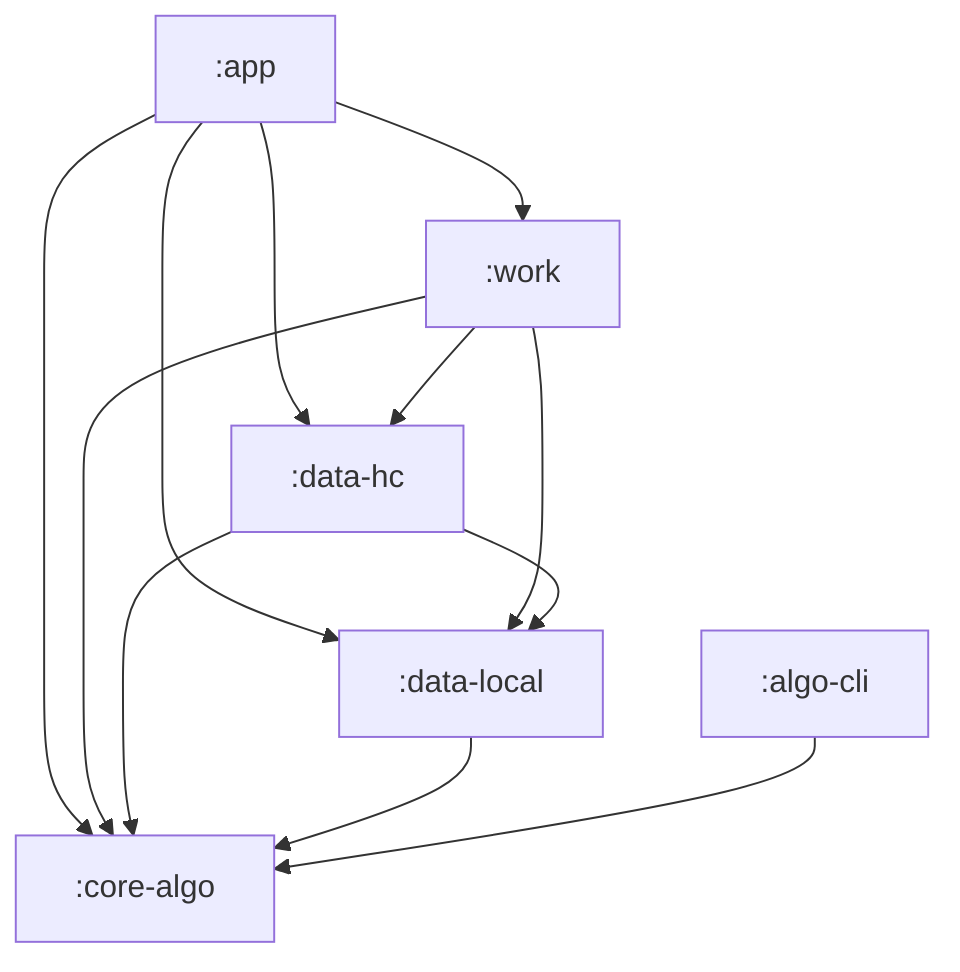
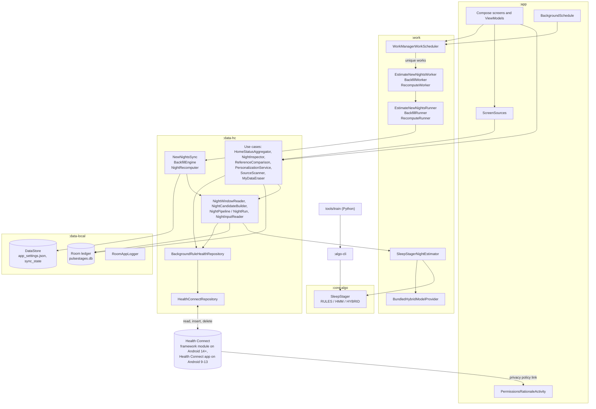
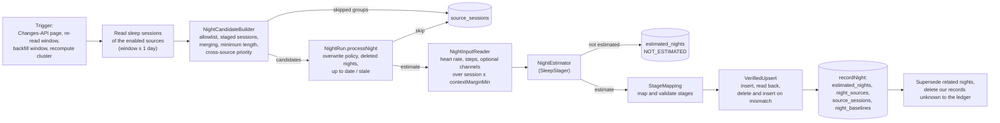
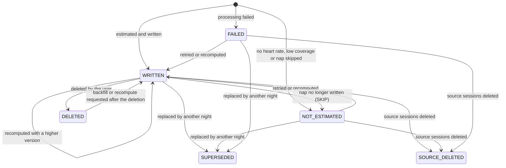

# Architecture

This document describes how PulseStages is built: the Gradle modules and the rule that keeps them layered, how a
night travels from Health Connect through the estimator and back into Health Connect, the local ledger that makes
every write idempotent, the background work, error handling and the test strategy.

It is written for developers. The code is the source of truth; class and file names are given so that every
statement can be checked. Related documents:

- [health-connect.md](health-connect.md): every Health Connect call, the record PulseStages writes and its notes
  format.
- [privacy.md](privacy.md): what data is processed and stored, and how to delete it.
- [ALGORITHM.md](../ALGORITHM.md): the estimators and their validation (the authoritative source for numbers).
- [PLAN.md](../PLAN.md): decisions and the verified Health Connect facts behind them.
- [INTERCHANGE.md](INTERCHANGE.md): file formats shared between the Kotlin code and `tools/train`.
- [development.md](development.md): building, testing and releasing.

Contents:

- [1. Modules](#1-modules)
- [2. Components](#2-components)
- [3. Data flow of one night](#3-data-flow-of-one-night)
- [4. The Room ledger and other local state](#4-the-room-ledger-and-other-local-state)
- [5. Idempotency](#5-idempotency)
- [6. Background work](#6-background-work)
- [7. Error handling](#7-error-handling)
- [8. Testing strategy](#8-testing-strategy)
- [9. Key source files](#9-key-source-files)

## 1. Modules

| Module | Kind | Responsibility |
|---|---|---|
| `:core-algo` | Kotlin/JVM library (`kotlin.jvm` plugin, no Android) | Preprocessing, features, the RULES / HMM / HYBRID estimators, post-processing, metrics, personalization, the params hash, CSV export, the synthetic night generator. Facade: `SleepStager`. |
| `:algo-cli` | Kotlin/JVM application | Command-line front end of `:core-algo` (`features`, `evaluate`, `estimate`, ...). `tools/train` calls it so that training and validation use exactly the code that runs on the phone ([INTERCHANGE.md](INTERCHANGE.md#2-algo-cli-commands)). |
| `:data-local` | Android library | The Room ledger (`pulsestages.db`), the settings DataStore, the sync-state DataStore, the internal logger, the UTC `Clock` and the application `CoroutineScope`. |
| `:data-hc` | Android library | The `HealthRepository` boundary and its Health Connect implementation, the night pipeline (candidate building, estimation, idempotent writing), the Changes-API sync, the backfill engine, recompute, the data eraser, the source scanner, and the use cases the UI calls. Test doubles in `src/testFixtures`. |
| `:work` | Android library | WorkManager workers, the runners behind them, the scheduler, the foreground notifications, the production `NightEstimator` (`SleepStagerNightEstimator`) and the loader of the bundled model. |
| `:app` | Android application | Compose Material 3 UI, the Hilt component root (`PulseStagesApp`), the manifest, the permission-rationale activity, platform services (Storage Access Framework, FileProvider, PackageManager), the model asset `assets/models/hybrid_model.json`, and the debug-only demo mode. |
| `tools/train` | Python (not a Gradle module) | Dataset download, OHealth emulation, training and leave-one-subject-out validation ([tools/train/README.md](../tools/train/README.md)). |

### 1.1 The dependency rule

Project dependencies point only downwards:



`:core-algo` depends on no other module and on nothing from Android. The rule is enforced by the build, not by
convention:

| Check | Where | What it rejects |
|---|---|---|
| `:verifyModuleGraph` | root `build.gradle.kts` | any project dependency outside the edges above, and any Android Gradle plugin applied to `:core-algo`. It runs with `check` and before `:core-algo:test`, so `./gradlew test` enforces it. |
| `:core-algo:verifyPureJvmRuntimeClasspath` | `core-algo/build.gradle.kts` | any `androidx.*`, `com.android.*` or `com.google.android.*` artifact on the runtime classpath of `:core-algo`. A dependency of `:core-algo:test`. |
| `NoAndroidImportsTest` | `:core-algo` tests | an `android`, `androidx`, `com.android` or `com.google.android` import in the main sources of `:core-algo`. |

Modules expose the types of lower modules that appear in their public API with `api(...)` (for example `:data-hc`
exposes `:core-algo` and `:data-local`, because `NightInput`, `AlgoParams` and the DAOs appear in its signatures).

### 1.2 Dependency injection

Hilt builds one `SingletonComponent`. Each module contributes its own bindings:

| Hilt module | Provides |
|---|---|
| `DataLocalModule`, `DatabaseModule`, `DataLocalBindingsModule` (`:data-local`) | the application scope (SupervisorJob, `Dispatchers.Default`), `Clock.systemUTC()`, the settings and sync-state DataStores, the Room database with `LedgerMigrations.ALL`, the DAOs, `AppLogger`, `SettingsRepository` |
| `DataHcModule`, `DataHcBindingsModule` (`:data-hc`) | the own package name, the IO dispatcher for Health Connect calls, the Default dispatcher for estimation, `RetryPolicy.DEFAULT`, the foreground-state check, `HealthConnectRepository` (qualified `@PlatformHealthRepository`) behind the unqualified `HealthRepository` = `BackgroundRuleHealthRepository` |
| `WorkModule`, `WorkBindingsModule` (`:work`) | `NightEstimator` = `SleepStagerNightEstimator`, `HybridModelProvider` = `BundledHybridModelProvider`, `WorkScheduler` = `WorkManagerWorkScheduler`, retry limits, the device time zone |
| `AppModule`, `AppBindingsModule`, `ScreenSourcesModule` (`:app`) | SAF documents, FileProvider sharing, app labels and icons, the screen data sources. `ScreenSourcesModule` exists twice: `src/release` binds the real sources only, `src/debug` can switch to synthetic demo data at runtime ([SCREENSHOTS.md](SCREENSHOTS.md)). |

WorkManager is initialized on demand through `Configuration.Provider` in `PulseStagesApp`, with Hilt's
`HiltWorkerFactory`; the manifest removes WorkManager's default initializer.

## 2. Components



- **UI.** One activity (`MainActivity`) with four tabs: Home, Nights, Compare, Settings (`TopLevelDestination`);
  Sources and Log are reached from Settings. ViewModels call use cases and the `WorkScheduler`; they never call Health
  Connect directly.
- **Use cases** report Health Connect problems as values instead of throwing: `UseCaseResult` (success, not found,
  not estimated, blocked, failed) for the night inspection and the reference comparison, dedicated result types such
  as `CalibrationOutcome` for personalization ([7.5](#75-use-cases-and-the-ui)). "Delete my sessions from Health
  Connect" and "Delete my session" call `MyDataEraser` directly from their ViewModels, while the app is in the
  foreground; they are not works.
- **Jobs** (`NewNightsSync`, `BackfillEngine`, `NightRecomputer`) decide which nights to process; the **pipeline**
  (`NightPipeline` and its per-call `NightRun`) processes them. Every job runs inside a WorkManager worker.
- **`HealthRepository`** is the only boundary to Health Connect. Everything above it works with plain Kotlin models
  (`HcSleepSession`, `HrSample`, `EstimatedSessionWrite`, ...) and with `HealthDataException`, which keeps the
  pipeline testable on the JVM with a fake repository.

## 3. Data flow of one night



### 3.1 Reading the sessions

`NightWindowReader` reads the sleep sessions of the enabled source packages whose **start** lies in the requested
range, padded by one day on both sides (`OVERLAP_MS`), so that the fragments of a night crossing the range boundary
are merged correctly. A backfill window then keeps only the nights whose first fragment starts inside it
(`CandidateSet.ownedBy`), so a night that spans two windows is processed exactly once. Our own package is never a
source (`enabledPackages` removes it).

Health Connect filters reads by record start time, not by overlap; [health-connect.md](health-connect.md#32-start-time-filtering-and-the-24-hour-left-padding)
explains this and the padding of heart-rate and step reads.

### 3.2 Building candidates

`NightCandidateBuilder.build` is pure and deterministic. Its steps, in order:

1. **Own sessions and the allowlist.** Sessions written by PulseStages are set aside (recorded as `OWN`, never
   estimated). Sessions of packages that are not enabled in `sources.sourcePackages` are ignored.
2. **Sessions with stages.** A session whose stages contain any type other than `STAGE_TYPE_UNKNOWN` (0) or
   `STAGE_TYPE_SLEEPING` (2) already has real stages and is skipped (`HAS_STAGES`), unless the overwrite policy is
   `RECOMPUTE_ALL`.
3. **Fragment merging.** Per package, sessions sorted by start are merged while the gap to the merged end is shorter
   than `sources.mergeGapMin` (overlaps included). The gaps become forced-AWAKE spans. The zone offsets are the first
   fragment's start offset and the last-ending fragment's end offset; when a source gives none, the device's current
   zone is used (`SystemZoneOffsetProvider`), and for a night the ledger already knows, the offsets stored there
   (`NightRun.withLedgerOffsets`), so a later change of the phone's time zone neither counts as a source change nor
   rewrites a historical offset.
4. **Minimum length.** A merged session shorter than `sources.minSessionMin` is ignored. It is recorded with the
   persisted outcome name `NAP`, which predates the nap mode.
5. **Night or nap.** Every remaining candidate is a nap when the merged session (gaps included) is strictly shorter
   than `algo.napMode.maxSessionMin`, otherwise a night (`AlgoParams.modeOf`). The mode selects the estimator,
   the post-processing and decoder overrides and the output policy ([ALGORITHM.md §18](../ALGORITHM.md#18-night-and-nap-modes-napmode)).
6. **Cross-source priority.** Nights of different packages that overlap by more than half of the shorter one are
   one sleep. The night whose package comes first in `sources.sourcePriority` is kept (unlisted packages last, then
   by name); the others become `LOWER_PRIORITY_DUPLICATE`. Details:
   - Sessions with their own stages take part (merged and length-filtered like the others). A staged night of a
     higher-priority source makes the overlapping nights of lower-priority sources duplicates, although it is never
     estimated itself.
   - **A piece of a night never replaces it.** A night that lies mostly inside a session of another package but covers
     at most half of it is a duplicate of that session whatever the priority, as long as that session is kept
     itself. Containers are decided first; a piece whose containers all lost is decided by priority like any night.
   - A nap under `napMode.outputPolicy` = `SKIP` writes nothing and therefore outranks nothing: an overlapping night
     of a lower-priority source is estimated instead.

The result is a `CandidateSet`: `candidates` to process, `skipped` groups with their outcome and an English reason,
and `own` sessions.

### 3.3 Deciding per night

`NightRun.processNight` looks the candidate up in the ledger by its `clientRecordId` and by its source uuids, then
decides:

| Situation | Result |
|---|---|
| A WRITTEN output exists and `overwritePolicy` = `NEVER` | not rewritten |
| A WRITTEN output exists and the source boundaries, zone offsets or fragment times changed | recomputed (every policy except `NEVER`) |
| A WRITTEN output exists and the policy is `RECOMPUTE_ALL`, or the trigger is an explicit recompute | recomputed |
| A WRITTEN output exists with the current `ALGO_VERSION` and params hash | up to date, skipped |
| A WRITTEN output exists with another version or hash (`SKIP_SAME_VERSION`) | left **stale**: never recomputed silently |
| The night (or a night sharing a source session) was deleted by the user | skipped, unless the trigger recreates deleted nights (backfill, recompute) and the deletion happened before the run was requested |
| `NEVER` and an overlapping night already has an output | not written |
| Otherwise | estimated and written |

Even when a WRITTEN night is skipped, nights it replaces are superseded and its source rows are refreshed (except
under `NEVER`).

The triggers are `PipelineTrigger.NEW_NIGHTS` (sync), `BACKFILL` and `RECOMPUTE`. Only `RECOMPUTE` forces a recompute;
`BACKFILL` and `RECOMPUTE` recreate deleted nights.

### 3.4 Estimation

`NightInputReader` is the single reader of estimation inputs, used by the pipeline, the night detail, the reference
comparison and personalization:

- heart rate and steps over `[start − contextMarginMin, end + contextMarginMin]` (`algo.preprocess.contextMarginMin`,
  30 min by default), from the night's own package (`sources.hrSources` = `SAME_AS_SLEEP`) or from any origin (`ANY`);
- SpO2, respiratory rate and HRV over the same window, only when enabled in the parameters (`features.useSpo2`,
  `useRespiratoryRate`, `useHrv`) **and** granted;
- the forced-AWAKE gaps between merged fragments;
- the rolling baseline nadir of earlier nights (`NightBaselineDao.baselineBefore`, the median of the last
  `features.baselineNights` nights that lasted at least the nap threshold; at least 3 such nights are needed). A nap
  gets no baseline.

`NightEstimator.estimate` runs on the Default dispatcher. The production implementation, `SleepStagerNightEstimator`
in `:work`, wraps core-algo's `SleepStager` with the bundled hybrid model (`BundledHybridModelProvider`, loaded once
from `assets/models/hybrid_model.json`; absent or invalid means HYBRID falls back to the HMM) and the personal model
that is active in the ledger. It rebuilds the stager only when the bundle or the active personal model changed, so
`paramsHash` always describes the configuration the next estimate uses. The algorithm itself is described in
[ALGORITHM.md §2](../ALGORITHM.md#2-pipeline-overview).

The outcome is either `Estimated` or `NotEstimated` (`NO_HR_DATA`, `LOW_COVERAGE`, `SESSION_TOO_SHORT`,
`NAP_SKIPPED`). A nap under the `SKIP` output policy is decided before any heart rate is read.

### 3.5 Writing

`NightRun.write`:

1. maps the estimated stages to Health Connect stage types (`StageMapping.toHcStages`, or `toSleepWakeHcStages` for a
   nap with the `SLEEP_WAKE` output policy);
2. validates them (`StageMapping.validate`): non-empty, sorted, contiguous, covering the session exactly, only
   written types, every stage at least one epoch long. A violation is a bug upstream: the night is marked FAILED
   (`InvalidStagesException`);
3. computes `clientRecordVersion` ([5.1](#51-record-keys));
4. writes through `HealthRepository.writeEstimatedSession` ([5.3](#53-read-back-verification));
5. stores the result in one Room transaction (`EstimatedNightDao.recordNight`: the night row, its source links, the
   source rows and, for a WRITTEN night with a nadir, its baseline row);
6. supersedes the nights this one replaces and deletes our own Health Connect records of the same night that the
   ledger does not know ([5.4](#54-one-output-per-night)).

The written record is specified in [health-connect.md §4](health-connect.md#4-data-written).

## 4. The Room ledger and other local state

### 4.1 Tables

`PulseStagesDatabase` (`pulsestages.db`, schema version 2):

| Table | Key | Content |
|---|---|---|
| `estimated_nights` | `id`; `clientRecordId` unique | One row per output night: source uuids and package, session start / end and zone offsets, our Health Connect record id (`hcRecordId`, non-null exactly while we believe our record exists), `algoVersion`, `paramsHash`, estimator, model id, coverage, confidence, `recomputeCount`, `clientRecordVersion`, `status` and `statusReason`, minutes per stage, flags (elevated heart rate, low confidence, calibrated, rules fallback), warnings, nadir, heart-rate sample count, the stages (`stagesJson`), timestamps, `mode` (NIGHT / NAP) and `sleepWakeOnly`. |
| `night_sources` | (`clientRecordId`, `sourceUuid`) | Links a night to each of its source sessions (indexed by `sourceUuid`). |
| `source_sessions` | `uuid` | Every source session seen: package, start, end, `outcome` (`ESTIMATED`, `NAP`, `HAS_STAGES`, `OWN`, `LOWER_PRIORITY_DUPLICATE`, `NOT_ESTIMATED`, `FAILED`, `DELETED`), reason, the night it belongs to, `lastSeenAt`. The Home counters are built from it. |
| `night_baselines` | `clientRecordId` | Heart-rate nadir and end of every written session, for the rolling baseline. Naps get a row too; the baseline query counts only sessions at least as long as the nap threshold, so a changed threshold applies to the whole history. |
| `personal_models` | `id` | Personal models (`CALIBRATED` or `EM`) as core-algo JSON with their fingerprint; at most one is active ([INTERCHANGE.md §4](INTERCHANGE.md#4-personal-model-personalmodeltojson-stored-by-data-local-in-the-room-table-personal_models) describes the JSON). |
| `backfill_state` | single row (`id` = 0) | Status (`IDLE`, `RUNNING`, `DONE`, `CANCELLED`, `FAILED`, `WAITING_RETRY`), range, cursor, window length (7 days), window and night counters, `historyLimited`, last error. |
| `log_entries` | `id` | The internal log, trimmed to the newest 10,000 rows ([7.6](#76-logging)). |

A night's status (`NightStatus`) follows this lifecycle. "Stale" is not a status: a WRITTEN night (or a nap skipped
by the nap policy) is stale when its `algoVersion` or `paramsHash` differs from the current ones
(`EstimatedNightEntity.isStale`).



The diagram shows the main transitions, not every corner case; `NightPipeline` and `NightRun` hold the complete
rules.

### 4.2 Schema versions and migrations

Every schema version is exported to `data-local/schemas/` (`1.json`, `2.json`), and every later version ships a
migration in `LedgerMigrations`. There is deliberately **no destructive fallback**: the ledger is what keeps the
Health Connect writes idempotent. Version 2 added `estimated_nights.mode` and `sleepWakeOnly`; the migration marks
rows of sessions shorter than 180 min (the version-1 nap threshold, fixed in the migration) as naps.
`LedgerMigrationTest` builds a version-1 database from the exported schema, opens it with the current database and
the migrations, and checks every row.

### 4.3 DataStore

| File | Owner | Content |
|---|---|---|
| `app_settings.json` | `SettingsRepository` (`AppSettingsDataStoreFactory`) | The settings as JSON. Only values that differ from the defaults are stored, so data-driven defaults (for example a retrained model's decoder values) still update for every value the user never changed. A corrupted file is reset to defaults and logged. Export writes every value ([settings-reference.md](settings-reference.md)). |
| `sync_state` (Preferences DataStore) | `SyncStateStore` | The Changes-API token and the package set it was created for, its creation and last-update times, the start, end, outcome and detail of the last sync, and the night count of the last population-EM run. A corrupted file is replaced by an empty state; the next run takes a new token. |

### 4.4 The ledger lock

`LedgerLock` is a process-wide, non-reentrant `Mutex` around every change of the ledger together with the matching
Health Connect writes. `NightPipeline.process`, `supersedeLeftovers`, `applyDeletions`, `retireRemnants`, the
`MyDataEraser` operations and switching the active personal model hold it, so a sync, a backfill, a recompute and an
erase never interleave, and one pipeline run computes its params hash and estimates all its nights with the same
personal model.

## 5. Idempotency

The goal: running any job any number of times, in any order, after a crash or after a reinstall, leaves exactly one
PulseStages record per night in Health Connect, and never touches another app's data.

### 5.1 Record keys

- **`clientRecordId`** = `"ps:"` + the lower-case SHA-256 hex of the night's source session uuids, de-duplicated,
  sorted and joined with `,` (`NightKeys.clientRecordId`). The same source sessions always give the same key.
- **`clientRecordVersion`** = `ALGO_VERSION · 1000 + recomputeCount` (`ALGO_VERSION` is 1 in this release, so 1000,
  1001, ...). `recomputeCount` grows by one on every rewrite, and `NightRun.nextRecomputeCount` makes sure the version
  is never below the version already stored in Health Connect plus one (read from our own records around the run's
  nights, so this also holds after a reinstall).

### 5.2 Upsert semantics (verified in AOSP)

The Jetpack and platform documentation only promise that, for the same `clientRecordId`, "the higher version takes
precedence". The behaviour PulseStages relies on was read in the AOSP HealthFitness module sources, branches
android14-release, android15-release, android16-release, android16-qpr2-release and android17-release
([PLAN.md §4](../PLAN.md#4-health-connect--verified-facts-connect-client-110-sources--aosp-healthfitness)):

- With a `clientRecordId`, the platform derives the record id as a name-based UUID of (package name, record type,
  `clientRecordId`) (`StorageUtils.addNameBasedUUIDTo`). The id is stable across re-inserts and can never collide with
  another app's record.
- A second insert with the same id updates the stored row **in place** when `newVersion >= storedVersion`, and is
  **silently ignored** otherwise (`RecordHelper.getUpsertTableRequest`,
  `TransactionManager.insertOrReplaceOnConflict`). An equal version overwrites.
- On Android 9–13 the Health Connect app is closed source; only the documented "higher version wins" applies there.

Sources (android16-qpr2-release):
[TransactionManager.java](https://android.googlesource.com/platform/packages/modules/HealthFitness/+/refs/heads/android16-qpr2-release/service/java/com/android/server/healthconnect/storage/TransactionManager.java),
[RecordHelper.java](https://android.googlesource.com/platform/packages/modules/HealthFitness/+/refs/heads/android16-qpr2-release/service/java/com/android/server/healthconnect/fitness/recordhelpers/RecordHelper.java),
[StorageUtils.java](https://android.googlesource.com/platform/packages/modules/HealthFitness/+/refs/heads/android16-qpr2-release/service/java/com/android/server/healthconnect/storage/utils/StorageUtils.java).

PulseStages never uses `updateRecords` (it fails for a record that does not exist) and never writes a session of its
own without a `clientRecordId`.

### 5.3 Read-back verification

`VerifiedUpsert.write` performs every write:

1. `insertRecords` with the single record (an upsert by `clientRecordId`);
2. read our own sessions starting within ±60 s of the session start (`VERIFY_LOOKUP_MARGIN_MS`) and compare the
   stored `clientRecordVersion` and stage count with what was written;
3. on a mismatch (a higher stale version is stored, or the Health Connect app on Android 9–13 ignored the insert):
   delete the record by `clientRecordId`, insert it again and verify once more;
4. a second mismatch is reported as `HealthDataException.InvalidData`, never accepted silently.

The ledger stores the version that was actually read back.

### 5.4 One output per night

A night must never have two PulseStages records. The pipeline enforces this in several places:

- **Superseding.** After a write, the nights the new one replaces are deleted by `clientRecordId` and marked
  SUPERSEDED: nights sharing a source uuid with it, and WRITTEN nights overlapping it (same package, or another package
  by more than half of the shorter night). This happens, for example, when a new fragment joins a night: the uuid set
  and therefore the `clientRecordId` change. Under `NEVER` a night that would replace an existing output is not
  written, and no output is deleted.
- **Our records unknown to the ledger.** Our own records in Health Connect around the run's nights are read once per
  run (`storedOwnSessions`, ±24 h). After a write, every such record with another `clientRecordId` whose notes list one
  of the night's source uuids (`SessionText.sourceUuidsOf`), or that overlaps the night by more than half, is deleted
  unless the ledger holds it as a WRITTEN night. This covers records written before a reinstall or "clear data", and
  records left behind by a failed delete.
- **Leftover repair.** Every sync starts with `NightPipeline.supersedeLeftovers`: a WRITTEN night whose source session
  now belongs to another WRITTEN night (the newer night was written, but superseding the older one failed or was
  interrupted) is superseded now.
- **Staged sources.** After the nights of a run, `retireStagedOutputs` retires our outputs that sessions with real
  stages made unnecessary: a source session that got its own stages after we estimated it, or a night that a
  higher-priority source recorded with its own stages (never under `NEVER`).
- **Skipped naps.** A nap under the `SKIP` output policy deletes its own earlier output and our records listing one of
  its source sessions; overlapping nights of other packages keep their outputs.

### 5.5 Deleted source sessions

`NightPipeline.applyDeletions` handles the ids of deleted source sessions (from `DeletionChange`s, or found missing by
a time-range re-read, [health-connect.md §5](health-connect.md#5-changes-api)):

- the source rows are marked `DELETED`;
- a night whose every source is gone loses our record (deleted by `clientRecordId`) and becomes SOURCE_DELETED; its
  time span is read again, so that a night of another source that was its lower-priority duplicate can be estimated
  now;
- a night with remaining sources is rebuilt from them; if the rest no longer forms a night (or cannot be estimated),
  `retireRemnants` deletes our record and marks it SOURCE_DELETED (under `NEVER` a night whose remaining sessions still
  form a night keeps its output);
- the spans of deleted sessions that had their own stages are read again, so a lower-priority night they outranked is
  estimated.

### 5.6 Reinstall and cleared data

Backups are off (`android:allowBackup="false"` plus extraction rules that exclude every domain), so a reinstall or
"clear storage" starts with an empty ledger and default settings. The records PulseStages wrote stay in Health
Connect. The design keeps the "one output per night" rule anyway:

- the same source sessions give the same `clientRecordId`, so re-estimating a night updates the existing record in
  place;
- the next version is derived from the version stored in Health Connect ([5.1](#51-record-keys)), so it is never
  below it;
- our records of the same night under another `clientRecordId` are found through their notes or their overlap and
  deleted ([5.4](#54-one-output-per-night));
- "Delete my sessions from Health Connect" reads all our own records (`readOwnSessions` over the full range) in
  addition to the ledger, so it also removes records written before the reinstall.

On Android 9–13 the 30-day history limit also applies to the app's own records
([health-connect.md §3.4](health-connect.md#34-history)). Without `READ_HEALTH_DATA_HISTORY`, records from more than 30
days before the new grant are not returned by these reads, so the steps above that read our records do not reach them.

### 5.7 Crash consistency

The order inside a write is: Health Connect insert and verification, then the ledger transaction, then superseding.

- If the process dies after the insert but before the ledger transaction, the ledger does not know about the write.
  The next run that processes the night writes it again under the same `clientRecordId`, with a version above the one
  stored in Health Connect, so no second record appears. The Changes-API token is persisted only after a page was
  processed completely, so an interrupted page is fetched again, and WorkManager runs an interrupted backfill or
  recompute again.
- If the process dies before superseding, the next sync's leftover repair finishes it.
- A backfill persists its cursor after every window and resumes from it; a recompute of "all" or "stale" skips the
  nights whose ledger row changed after the request (`notUpdatedSinceMs`).

### 5.8 Params hash and staleness

`NightPipeline.currentParamsHash` = SHA-256 (lower-case hex) of the canonical JSON of `AlgoParams` +
`"|model="` + the bundle fingerprint + `"|personal="` + the active personal model's fingerprint (when personalization
is enabled) + `"|"` + the extra string
`awakeAsLight=…;hrSources=…;spo2=…;respiratoryRate=…;hrv=…` (`ParamsHasher.hash`, `OutputOptions.hashExtra`,
`InputSelection`). The title template is deliberately not part of it. A WRITTEN night with another `ALGO_VERSION` or
hash is stale; stale nights are recomputed only on request (Home "Recompute stale nights", the offer that Settings
shows after a change, or "Recompute" on one night) or under `RECOMPUTE_ALL`. Which settings enter the hash is listed
in [settings-reference.md](settings-reference.md).

## 6. Background work

### 6.1 Works

All background work runs on WorkManager. Every job is a **unique work**, so repeated requests never pile up.

| Work | Unique name | Request | Started by | Foreground service |
|---|---|---|---|---|
| `EstimateNewNightsWorker` (periodic) | `estimate-periodic` | periodic, every `schedule.periodicHours` hours (default 1) | app start and every change of the schedule settings | no |
| `EstimateNewNightsWorker` (daily) | `estimate-daily` | periodic, 24 h, next run pinned to `schedule.dailyTimeMinutes` local time (default 09:00) | the same | no |
| `EstimateNewNightsWorker` (now) | `estimate-now` | one-time, expedited (normal work when the expedited quota is used up) | Home "Estimate new" | yes |
| `BackfillWorker` | `backfill` | one-time | Home "Backfill history" / "Resume backfill" | yes |
| `RecomputeWorker` (all or stale) | `recompute-all` | one-time | Home "Recompute all" / "Recompute stale nights", the Settings recompute offer | yes |
| `RecomputeWorker` (one night) | `recompute-night:<clientRecordId>` | one-time, expedited | night detail "Recompute" | yes |

Every request carries the tag `pulsestages`, a job tag (`estimate`, `backfill`, `recompute`) and exponential backoff
starting at 30 s (`WorkRequests.BACKOFF_DELAY_MS`; WorkManager doubles it per retry up to 5 hours). The workers are
thin adapters: each calls its runner (`EstimateNewNightsRunner`, `BackfillRunner`, `RecomputeRunner`), which holds
the logic without WorkManager and is tested on its own.

### 6.2 Schedules and constraints

- `PulseStagesApp.onCreate` starts `BackgroundSchedule`, which calls `WorkScheduler.keepScheduled` in the application
  scope: the periodic and the daily work are made to match the schedule settings now and after every change.
- Each periodic work carries a tag that encodes its schedule (for example
  `schedule:periodic:1h:batteryNotLow=true`). A work whose tag no longer matches the settings is re-enqueued with
  `ExistingPeriodicWorkPolicy.UPDATE` (a running work is not interrupted).
- The daily work is a 24-hour periodic work with an initial delay and a next-schedule-time override pointing at the
  next configured local time (`DailySchedule.nextRunMs`, which also handles DST gaps). After every daily run that is
  not a retry, the next run is pinned again (`realignDaily`); `ensureScheduled` also re-pins it when its next run
  drifted more than 30 min from the configured time. The time stays approximate: Doze and the constraint may delay it.
- Constraint: the periodic and daily works require "battery not low" when `schedule.runOnlyWhenNotLowBattery` is on
  (default). The one-time works the user starts have no constraints.
- Existing-work policies: `estimate-now` and the recompute of one night replace a pending request (one waiting for a
  backoff, for example) and keep a running one; the backfill and "recompute all" keep an existing request.

### 6.3 Results, retries and backoff

The runners return a `WorkOutcome`; `WorkResults` maps it to a WorkManager result:

| Outcome | Meaning | WorkManager result |
|---|---|---|
| `Completed` | the run finished (failed nights are logged and retried by later runs) | success, with the counters as output |
| `Blocked` | Health Connect unavailable, a required permission missing, or a background run without the background permission | success with outcome `BLOCKED` and the reason: nothing to retry until the user acts or the next period comes |
| `Retry` | quota or transient Health Connect error | retry while `runAttemptCount` < 20, then failure (`RETRY_EXHAUSTED`) |
| `Unexpected` | a bug or invalid data | retry while `runAttemptCount` < 3, then failure (`FAILED`) |
| `Failed` | a failure a retry cannot fix (a backfill that stored FAILED) | failure at once |

A failed periodic work still runs in its next period. The screens read the output data of finished works (outcome,
reason, counters, an English detail) to show the result of a run the user started; Home's "Last run" comes from
`SyncStateStore`, which every sync updates.

### 6.4 Foreground service

The runs the user asks for (backfill, recompute, "Estimate new") call `setForeground` with a notification on the
low-importance channel `pulsestages.work` and the foreground-service type `dataSync`. This keeps their Health Connect
reads foreground reads when the user leaves the app. The manifest declares `FOREGROUND_SERVICE`,
`FOREGROUND_SERVICE_DATA_SYNC` and `POST_NOTIFICATIONS`, and sets `foregroundServiceType="dataSync"` on WorkManager's
`SystemForegroundService` (required on Android 14+; `MergedManifestTest` checks it). When the platform refuses a
foreground service (for example from the background on Android 12+), the work continues without one and is then
treated as a background run. Without the notification permission (Android 13+) the work still runs; the notification
is just not shown. Expedited works on Android 11 and lower also run as a foreground service with these
notifications.

### 6.5 The background-permission guard

Without `READ_HEALTH_DATA_IN_BACKGROUND`, Health Connect only serves an app's own data while the app is in the
background. Newer platform versions reject other reads with a `SecurityException`; android14-release silently
narrows the read to the caller's own records (AOSP `HealthConnectServiceImpl`, self-read enforcement). A silent empty
read would look like deleted source sessions to a re-read, like an empty history to a backfill and like nights without
sources to a recompute. PulseStages therefore refuses to read instead, in three layers:

1. **At the start of a run.** `WorkerSupport.inBackground()` decides from the app's real state, not from what started
   the run: the app counts as in the foreground only when its process importance is `IMPORTANCE_FOREGROUND` or
   `IMPORTANCE_FOREGROUND_SERVICE` (`ProcessImportanceForegroundState`). `HealthAccessGuard.check(inBackground)` then
   blocks the run with `BACKGROUND_PERMISSION_MISSING` when the permission is missing.
2. **On every read.** `BackgroundRuleHealthRepository`, the `HealthRepository` the whole app uses, checks the foreground
   state before every read of other apps' data (any origin, another package, the origin scan, the Changes API), and
   again after the call when the app was in the foreground before. It throws `PermissionDenied` when the app is (or
   became) a background caller without the permission; the result of a call during which the app left the foreground
   is discarded. Reads filtered to exactly our own package, the changes token, writes and deletes of our own records
   pass through.
3. **Classifying the refusal.** `HealthAccessGuard.reasonForDenial` reads the granted permissions again: when every
   required permission is still granted but the background permission is not, the refusal is
   `BACKGROUND_PERMISSION_MISSING`; otherwise a permission was revoked (`PERMISSION_MISSING`) or Health Connect is gone.

`EstimateNewNightsWorker` for "Estimate new" (`estimate-now`) first enters the foreground service and waits up to 3 s for the process
to be promoted (`FOREGROUND_SETTLE_MS`), so a run the user started reads as a foreground run.

### 6.6 Concurrency and cancellation

- `EstimateNewNightsRunner` serializes the periodic, daily and `estimate-now` runs with a mutex.
- `BackfillEngine` allows one run per process (`ALREADY_RUNNING` otherwise).
- Every ledger change holds `LedgerLock` ([4.4](#44-the-ledger-lock)).
- **Backfill cancel.** `cancelBackfill` asks a running backfill to stop before its next night and marks the state
  CANCELLED; a request that has not begun processing is removed from WorkManager. The cancel is durable: a retry or a
  re-run of the cancelled request processes nothing; only a backfill requested after the cancel starts over.
  Coroutine cancellation (WorkManager stopping the worker) leaves the state RUNNING, so it resumes from the cursor.
- **A deletion wins.** "Delete my sessions from Health Connect" cancels the backfill and every recompute requested
  before it, then waits for the ledger lock, so a night that a job may be finishing is erased as well. A backfill or
  recompute never writes again a night that was deleted after it was requested (`requestedAtMs`).

### 6.7 What a sync does

Every `EstimateNewNightsWorker` run calls `EstimateNewNightsRunner`, which runs `NewNightsSync.run`:

1. check Health Connect, the required permissions and the background rule;
2. repair leftover double outputs;
3. follow the Changes API with the stored token, or re-read recent nights by time range when there is no usable token
   ([health-connect.md §5](health-connect.md#5-changes-api) has the details);
4. retry nights without an estimate (NOT_ESTIMATED / FAILED): every run retries nights that ended in the last 36 h,
   because their heart rate may arrive after the session; nights that arrived late are retried with growing gaps;
5. record the outcome in `SyncStateStore`.

After a completed sync the runner runs the population EM adaptation when it is due
(`PersonalizationService.maybeRunPopulationEm`; only when the HMM emissions are in use,
[ALGORITHM.md §10](../ALGORITHM.md#10-personalization-personal)); a failure there is logged and does not fail the run.

## 7. Error handling

### 7.1 One exception type at the boundary

`HealthConnectRepository` wraps every client call (`mapHealthErrors`) and turns every exception except cancellation
into a `HealthDataException`:

| Subtype | From | Handling |
|---|---|---|
| `PermissionDenied` | `SecurityException`, platform error code `ERROR_SECURITY` | the run stops; classified by `reasonForDenial` |
| `QuotaExceeded` | `IllegalStateException` caused by a platform `HealthConnectException` with code 7 (`ERROR_RATE_LIMIT_EXCEEDED`) or 8 (`ERROR_DATA_SYNC_IN_PROGRESS`) | retried in the call; then the run stops with `quotaHit` and WorkManager retries it |
| `Transient` | `RemoteException`, `IOException`, other `IllegalStateException`s while Health Connect is available, anything unclassified | retried in the call; then the night fails (inside a night) or WorkManager retries the run (outside one) |
| `InvalidData` | `IllegalArgumentException` (including `NumberFormatException`), platform `ERROR_INVALID_ARGUMENT` | not retried in the call; the night fails (inside a night) or the run ends as unexpected (outside one) |
| `Unavailable` | `UnsupportedOperationException`, platform `ERROR_UNSUPPORTED_OPERATION`, an `IllegalStateException` while Health Connect is not available | the run stops as blocked |

The mapping and the platform error codes are explained in [health-connect.md §7](health-connect.md#7-errors-quotas-and-backoff).

### 7.2 Retries in the call

`retryHealthCall` retries `QuotaExceeded` and `Transient` with `RetryPolicy.DEFAULT`: waits of 1, 2, 4, 8 and 16 s,
at most six attempts and 31 s of waiting per call, without jitter so runs stay deterministic. Every retry is logged.
The tests run the waits in virtual time (`Sleeper`).

### 7.3 Per-night isolation

`NightRun.guarded` processes each night separately:

- `QuotaExceeded`, `PermissionDenied` and `Unavailable` stop the run (`Step.Stop`); the remaining nights are left for
  a later run;
- any other exception marks that night FAILED with the exception's class and message as reason (a night that has an
  output stays WRITTEN), is logged, and the run continues with the next night;
- cancellation is always rethrown.

### 7.4 Run reports

Each job reports instead of throwing: `PipelineReport` (found, estimated, skipped, stale, up to date, failed, not
estimated, superseded, `quotaHit`, `blockedReason`, `cancelled`), `SyncReport` with a `SyncOutcome`
(`SUCCESS`, `PARTIAL_FAILURE`, `QUOTA_EXCEEDED`, `PERMISSION_DENIED`, `HEALTH_CONNECT_UNAVAILABLE`,
`BACKGROUND_READ_BLOCKED`, `FAILED`, `CANCELLED`), and `BackfillReport` with a `BackfillOutcome`. The runners map
these to `WorkOutcome` ([6.3](#63-results-retries-and-backoff)); `guardedRun` turns any remaining `Throwable` except
cancellation into `Unexpected`, so a worker never throws.

### 7.5 Use cases and the UI

`NightInspector` and `ReferenceComparison` go through `runUseCase`: Health Connect errors become `UseCaseResult.Blocked`
(permission, background rule, Health Connect gone) or `UseCaseResult.Failed` (`retryable` for quota and transient
errors); any other exception is logged and becomes a non-retryable `Failed`. `PersonalizationService` reports its
own outcome types, and the Home and night-detail ViewModels catch the `HealthDataException` of a failed deletion
(`MyDataEraser`) and show a message. Screens show these states with their own texts and actions.

### 7.6 Logging

`AppLogger` (implemented by `RoomAppLogger`) never throws and never blocks on I/O: a line below the configured level
(`debug.logLevel`, default `INFO`) is dropped; the rest is mirrored synchronously to logcat with the tag `PulseStages`
and queued; a single writer coroutine stores the queue in batches and trims `log_entries` to the newest 10,000 rows.
Messages are capped at 8,000 characters and carry the stack trace of a throwable. A line about a night carries its
`clientRecordId` as `nightKey`. Storage failures go to logcat only. The Log screen shows and shares this log
([privacy.md §5](privacy.md#5-logs)).

## 8. Testing strategy

All Kotlin tests run on the JVM. There are no instrumented tests (`androidTest`) and no device UI tests; the Android 9–13
Health Connect app path has not been run on a device. The full check is:

```sh
mise exec -- ./gradlew assembleDebug test ktlintCheck detekt
```

CI runs `./gradlew ktlintCheck detekt test assembleDebug` and the Python tests of `tools/train`
([development.md](development.md)).

### 8.1 Layers

| Module | Runner | What is tested |
|---|---|---|
| `:core-algo` | JUnit 5, plain JVM | every algorithm part, invariants of every estimate (sorted, contiguous, covering the session), synthetic recovery, edge cases, the params hash, the CSV format, the night / nap modes (`NapModeRegressionTest` compares 767 estimates with digests recorded on the build before the two modes), and the shipped model bundle against this build (`BundledModelAssetTest`). Synthetic data guards invariants and regressions only; algorithm choices are made on the open datasets ([ALGORITHM.md §15](../ALGORITHM.md#15-synthetic-validation-regression-tests-only)). |
| `:algo-cli` | JUnit 5 | the commands and their file formats. |
| `:data-local` | JUnit 5; Robolectric (JUnit 4 through the Vintage engine) where Android SQLite is needed | the DAOs on a real Room database, the migration against the exported schemas, the settings JSON and validator, the DataStores, the logger, the module's Hilt graph. |
| `:data-hc` | JUnit 5; Robolectric for the Room cross-check and the Hilt graph | `HealthConnectRepository` against `FakeHealthConnectClient`, the error mapping, `VerifiedUpsert`, and the pipeline scenarios (merging, priority, staged sources, naps, deletions, repairs, recompute, erase, backfill, sync) against `FakeHealthRepository` and `InMemoryLedger`. |
| `:work` | JUnit 5; Robolectric with work-testing's test WorkManager | the runners, the `WorkOutcome` mapping, the work requests, the scheduler, the worker adapters (`TestListenableWorkerBuilder`), the estimator adapter. |
| `:app` | JUnit 5 for ViewModels; Robolectric for the app graph, wiring, rendering and screenshots | ViewModel state machines with fakes, the production Hilt graph, an end-to-end wiring test, render tests, screenshots, and the structural checks below. |

### 8.2 Fakes

- **`FakeHealthConnectClient`** (`:data-hc` tests) implements the real `HealthConnectClient` interface with the
  verified client behaviour: reads filter by record start time and data origin; pages end with `null`, or with `""`
  like the Android 9–13 path; a `""` token sent back throws `NumberFormatException` like the platform; inserts with a
  `clientRecordId` replace the stored record iff `newVersion >= storedVersion`; `deleteRecords` with two empty lists
  throws `IllegalArgumentException`; errors can be injected per operation. It tests `HealthConnectRepository` itself.
- **`FakeHealthRepository`** (`:data-hc` test fixtures, shared with `:work` and `:app`) emulates the Health Connect
  semantics behind `HealthRepository`: start-time reads with the 24 h left padding, origin filters, upserts with
  deterministic ids and the `>=` rule (or a stricter `>` rule), writes through the real `VerifiedUpsert`, deletes of
  own records only, a change log with tokens per package set, paging and expiry, the 30-day history limit, and both
  background behaviours (`BackgroundRule.THROWS` as on android15-release and later, `SELF_ONLY` as on
  android14-release).
- **`InMemoryLedger`** runs the real abstract DAO classes with their generated SQL replaced by equivalent Kotlin.
  `RoomLedgerCrossCheckTest` runs the same pipeline scenario on the real Room ledger (Robolectric) and on the in-memory
  ledger and requires identical ledgers and identical Health Connect contents; this is what justifies running the
  other pipeline tests on the in-memory ledger.
- **`FakeNightEstimator`**, `FakeSettingsRepository`, `TestClock`, `RecordingLogger` and `PipelineHarness` complete the
  test fixtures.

### 8.3 Robolectric offline

Robolectric runs offline in every Android module: the `android-all-instrumented` jar is resolved by Gradle into
`build/robolectric-deps` (`prepareRobolectricDependencies`) and the tests run with `robolectric.offline=true`, so no
test downloads anything.

### 8.4 App graph, wiring, render and screenshot tests

- **`RealAppGraphTest`** starts the production Hilt graph like the real app: `Application.onCreate` enqueues the
  periodic and daily work, `HiltWorkerFactory` creates every worker, and the chain reaches
  `BackgroundRuleHealthRepository` over the real `HealthConnectRepository` and the estimator with the bundled model
  read through the app's assets.
- **`EndToEndWiringTest`** uses the real graph with only the platform Health Connect repository replaced by
  `FakeHealthRepository`, drives the UI actions in order and checks their effect in "Health Connect" and the ledger.
- **Render tests** (`src/testDebug`, Robolectric native graphics: `SettingsRenderTest`, `HomeRenderTest`,
  `NightsRenderTest`, `OtherScreensRenderTest`) compose every screen in its main states in English and Russian, also
  at font scale 2 and in a wide window (the inner screen of a foldable). Any exception, and any text that still shows
  a format placeholder, fails them.
- **`ScreenshotsTest`** renders the documentation screenshots from synthetic data and fixed example states on every
  test run; `-PrecordScreenshots` writes them to `docs/screenshots/` ([SCREENSHOTS.md](SCREENSHOTS.md#the-screenshots-in-the-readme)).

### 8.5 Structural checks

| Test | Checks |
|---|---|
| `MergedManifestTest` | the merged debug and release manifests: no `INTERNET`, every health permission declared under `<manifest>`, the foreground-service permissions, the `<queries>` entries without `QUERY_ALL_PACKAGES`, the rationale activity and its Android 14+ alias, the `dataSync` type of WorkManager's service, the private FileProvider, the removed WorkManager initializer, exactly one launcher entry, no demo component |
| `ReleaseApkTest` | the minified release APK: R8's mapping lists no demo class, and aapt2's dump shows no demo resource or text (its inputs make `./gradlew test` build the release APK) |
| `ResourcesParityTest` | every string of every module in English and Russian, with the same placeholders and the plural forms of each language |
| `ResourceFormatsTest` | every string with `%` is a valid format pattern or marked `formatted="false"` |
| `SettingsTextsTest` | every text the settings catalog can produce resolves against the real English and Russian resources |
| `SettingsCatalogTest` | every leaf of the settings JSON is edited by exactly one setting (or on the Sources screen), and no path twice |
| `verifyModuleGraph`, `verifyPureJvmRuntimeClasspath`, `NoAndroidImportsTest` | the dependency rule ([1.1](#11-the-dependency-rule)) |
| ktlint, detekt | code style and static analysis; detekt also requires KDoc on the public API of `:core-algo` |

## 9. Key source files

| Topic | File |
|---|---|
| Health Connect boundary | [`HealthRepository.kt`](../data-hc/src/main/kotlin/io/github/alien2003/pulsestages/data/hc/HealthRepository.kt), [`HealthConnectRepository.kt`](../data-hc/src/main/kotlin/io/github/alien2003/pulsestages/data/hc/HealthConnectRepository.kt), [`BackgroundRuleHealthRepository.kt`](../data-hc/src/main/kotlin/io/github/alien2003/pulsestages/data/hc/BackgroundRuleHealthRepository.kt) |
| Errors and retries | [`HealthErrors.kt`](../data-hc/src/main/kotlin/io/github/alien2003/pulsestages/data/hc/HealthErrors.kt) |
| Record mapping and verified upsert | [`HcRecordMapper.kt`](../data-hc/src/main/kotlin/io/github/alien2003/pulsestages/data/hc/HcRecordMapper.kt), [`VerifiedUpsert.kt`](../data-hc/src/main/kotlin/io/github/alien2003/pulsestages/data/hc/VerifiedUpsert.kt) |
| Candidates and keys | [`NightCandidates.kt`](../data-hc/src/main/kotlin/io/github/alien2003/pulsestages/data/hc/pipeline/NightCandidates.kt) |
| Pipeline | [`NightPipeline.kt`](../data-hc/src/main/kotlin/io/github/alien2003/pulsestages/data/hc/pipeline/NightPipeline.kt), [`NightRun.kt`](../data-hc/src/main/kotlin/io/github/alien2003/pulsestages/data/hc/pipeline/NightRun.kt), [`NightInputReader.kt`](../data-hc/src/main/kotlin/io/github/alien2003/pulsestages/data/hc/pipeline/NightInputReader.kt) |
| Stages, title, notes | [`StageMapping.kt`](../data-hc/src/main/kotlin/io/github/alien2003/pulsestages/data/hc/pipeline/StageMapping.kt), [`SessionText.kt`](../data-hc/src/main/kotlin/io/github/alien2003/pulsestages/data/hc/pipeline/SessionText.kt) |
| Jobs | [`NewNightsSync.kt`](../data-hc/src/main/kotlin/io/github/alien2003/pulsestages/data/hc/pipeline/NewNightsSync.kt), [`BackfillEngine.kt`](../data-hc/src/main/kotlin/io/github/alien2003/pulsestages/data/hc/pipeline/BackfillEngine.kt), [`NightRecomputer.kt`](../data-hc/src/main/kotlin/io/github/alien2003/pulsestages/data/hc/pipeline/NightRecomputer.kt), [`MyDataEraser.kt`](../data-hc/src/main/kotlin/io/github/alien2003/pulsestages/data/hc/pipeline/MyDataEraser.kt) |
| Access checks and the ledger lock | [`HealthAccessGuard.kt`](../data-hc/src/main/kotlin/io/github/alien2003/pulsestages/data/hc/pipeline/HealthAccessGuard.kt) |
| Ledger | [`PulseStagesDatabase.kt`](../data-local/src/main/kotlin/io/github/alien2003/pulsestages/data/local/db/PulseStagesDatabase.kt), [`EstimatedNightEntity.kt`](../data-local/src/main/kotlin/io/github/alien2003/pulsestages/data/local/db/EstimatedNightEntity.kt), [`LedgerEntities.kt`](../data-local/src/main/kotlin/io/github/alien2003/pulsestages/data/local/db/LedgerEntities.kt), [`LedgerMigrations.kt`](../data-local/src/main/kotlin/io/github/alien2003/pulsestages/data/local/db/LedgerMigrations.kt) |
| Settings and sync state | [`AppSettings.kt`](../data-local/src/main/kotlin/io/github/alien2003/pulsestages/data/local/settings/AppSettings.kt), [`SyncStateStore.kt`](../data-local/src/main/kotlin/io/github/alien2003/pulsestages/data/local/sync/SyncStateStore.kt) |
| Work | [`WorkRequests.kt`](../work/src/main/kotlin/io/github/alien2003/pulsestages/work/schedule/WorkRequests.kt), [`WorkManagerWorkScheduler.kt`](../work/src/main/kotlin/io/github/alien2003/pulsestages/work/schedule/WorkManagerWorkScheduler.kt), [`Workers.kt`](../work/src/main/kotlin/io/github/alien2003/pulsestages/work/worker/Workers.kt), [`WorkerSupport.kt`](../work/src/main/kotlin/io/github/alien2003/pulsestages/work/worker/WorkerSupport.kt), [`Runners.kt`](../work/src/main/kotlin/io/github/alien2003/pulsestages/work/run/Runners.kt), [`WorkResults.kt`](../work/src/main/kotlin/io/github/alien2003/pulsestages/work/run/WorkResults.kt) |
| Estimator adapter | [`SleepStagerNightEstimator.kt`](../work/src/main/kotlin/io/github/alien2003/pulsestages/work/estimate/SleepStagerNightEstimator.kt), [`BundledHybridModelProvider.kt`](../work/src/main/kotlin/io/github/alien2003/pulsestages/work/estimate/BundledHybridModelProvider.kt) |
| Manifest | [`AndroidManifest.xml`](../app/src/main/AndroidManifest.xml), [`MergedManifestTest.kt`](../app/src/test/kotlin/io/github/alien2003/pulsestages/MergedManifestTest.kt) |
| Module rule | [`build.gradle.kts`](../build.gradle.kts), [`core-algo/build.gradle.kts`](../core-algo/build.gradle.kts) |
