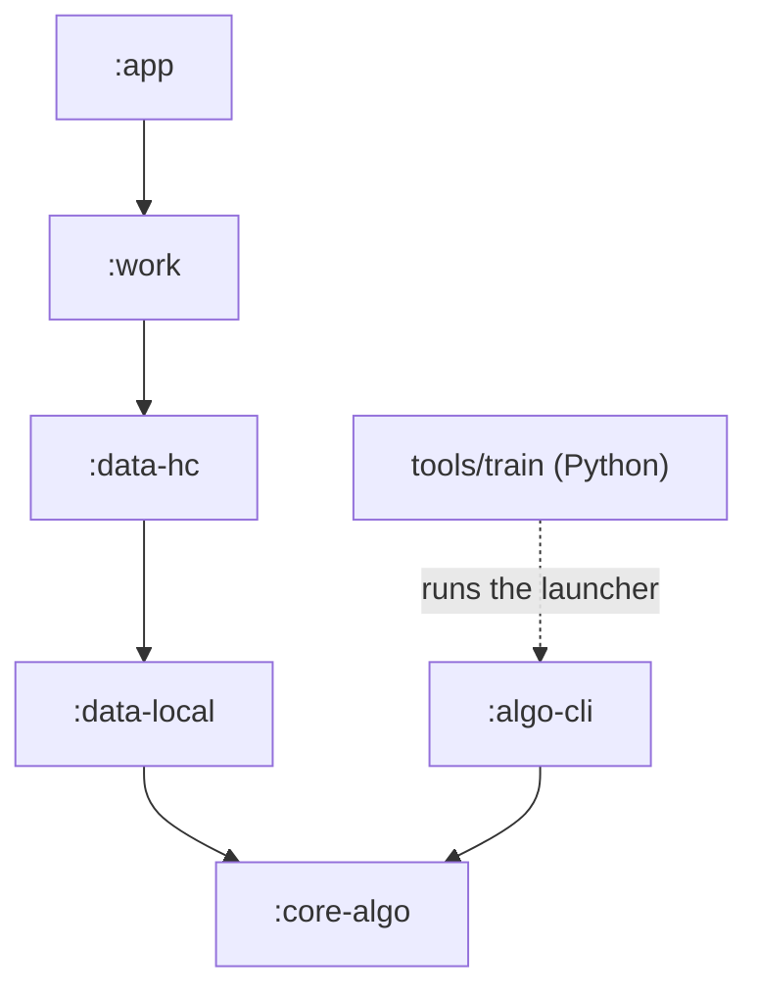

# Development

How to set up, build, test and release PulseStages, and the rules the code base follows. For how the app works
inside, see [architecture.md](architecture.md); for contribution rules, see [CONTRIBUTING.md](../CONTRIBUTING.md).

- [Requirements](#requirements)
- [One-time setup](#one-time-setup)
- [Build, test and lint](#build-test-and-lint)
- [Modules and the dependency rule](#modules-and-the-dependency-rule)
- [Conventions](#conventions)
- [Running on a phone](#running-on-a-phone)
- [Continuous integration](#continuous-integration)
- [Releases](#releases)
- [Training and validation](#training-and-validation)

## Requirements

- Linux, or WSL 2 (Ubuntu) on Windows. Keep the checkout in the Linux file system (`~/…`), not under `/mnt/c`.
- `git`, [mise](https://mise.jdx.dev/) (install it as its documentation describes:
  [Getting started](https://mise.jdx.dev/getting-started.html)), plus `curl`, `unzip` and `sha1sum` for the SDK
  download below.
- For installing on a phone from WSL: `adb.exe` on Windows (see [Running on a phone](#running-on-a-phone)).

Nothing is installed system-wide. mise keeps the JDK and Python in its per-user data directory (by default
`~/.local/share/mise`); the Android SDK, the Gradle user home and the Python virtual environment live in the project
folder:

| What | Where it comes from |
|---|---|
| Temurin 17 (JDK) and Python 3.12 | `.mise.toml` (`[tools]`), installed by mise per user |
| Python virtual environment | `tools/train/.venv`, created by mise (`_.python.venv`) |
| Android SDK | `.tooling/android-sdk` (`ANDROID_HOME` and `ANDROID_SDK_ROOT` are set by `.mise.toml`) |
| Gradle user home (wrapper distribution, caches) | `.tooling/gradle` (`GRADLE_USER_HOME`) |
| Gradle | the wrapper `./gradlew`, Gradle 9.8.1 (`gradle/wrapper/gradle-wrapper.properties`, with a distribution SHA-256) |
| Library and plugin versions | `gradle/libs.versions.toml` |
| `sdkmanager` and `platform-tools` on `PATH`, `ADB_WIN` | `.mise.toml` (`[env]`) |

`.tooling/` and `local.properties` are git-ignored. Run every command through `mise exec -- …` (or inside
`mise exec -- bash`) so that the project's JDK, Python and environment variables are used.

Toolchain levels: AGP 9.4.1 with its built-in Kotlin support, Kotlin 2.4.21, compileSdk 37 (the minor-versioned
platform `android-37.0`), targetSdk 36, minSdk 28, JVM target 17.
[PLAN.md §3](../PLAN.md#3-versions-verified-latest-stable-gradlelibsversionstoml) lists every library version and the
compatibility notes behind them.

## One-time setup

```sh
git clone https://github.com/alien2003/PulseStages.git ~/PulseStages
cd ~/PulseStages
mise trust          # only if mise asks to trust the project's .mise.toml
mise install        # Temurin 17 and Python 3.12

# Android command-line tools 23.0 (official zip; SHA-1 from Google's repository2-3.xml)
mkdir -p .tooling/dl .tooling/android-sdk/cmdline-tools
curl -fL -o .tooling/dl/cmdline.zip \
  https://dl.google.com/android/repository/commandlinetools-linux-16111833_latest.zip
echo "e025545c62a8e64c7559119566a569fb1dec5f60  .tooling/dl/cmdline.zip" | sha1sum -c -
unzip -q .tooling/dl/cmdline.zip -d .tooling/dl/extract
mv .tooling/dl/extract/cmdline-tools .tooling/android-sdk/cmdline-tools/latest

# SDK packages
yes | mise exec -- sdkmanager --licenses
mise exec -- sdkmanager "platform-tools" "platforms;android-36" "platforms;android-37.0" \
  "build-tools;36.0.0" "build-tools;37.0.0"
```

The project was set up with cmdline-tools 23.0, platform-tools 37.0.1, the platforms `android-36` and `android-37.0`,
and build-tools 36.0.0 and 37.0.0 ([PLAN.md §1](../PLAN.md#1-stages-one-conventional-commits-commit-each)). AGP 9.4 uses
build-tools 36.0.0 by default. The Linux platform-tools are not used to install on the phone from WSL (see below).

For the training tools (optional):

```sh
mise exec -- pip install -r tools/train/requirements.txt
```

## Build, test and lint

### Everyday commands

The full check:

```sh
mise exec -- ./gradlew test ktlintCheck detekt assembleDebug assembleRelease :app:compileDebugAndroidTestKotlin
```

CI runs `ktlintCheck detekt test assembleDebug` ([Jobs](#jobs)). `:app:compileDebugAndroidTestKotlin` compiles the
on-device end-to-end suite, which CI does not build: a changed constructor, or a new member of an interface the suite
implements (`HealthRepository`, `NightEstimator`, `AppLogger`), breaks it without failing CI.

| Command | What it does |
|---|---|
| `./gradlew assembleDebug` | Debug APK `app/build/outputs/apk/debug/app-debug.apk` |
| `./gradlew assembleRelease` | Minified release APK; unsigned (`app-release-unsigned.apk`) unless the signing variables are set ([Local signed build](#local-signed-build)) |
| `./gradlew test` | Every JVM test of every module. It also runs `:verifyModuleGraph` and `:core-algo:verifyPureJvmRuntimeClasspath`, and builds the minified release APK that `ReleaseApkTest` inspects |
| `./gradlew :app:testDebugUnitTest --tests '*SettingsRenderTest'` | One test class. Android modules have only the `testDebugUnitTest` unit-test task (the AGP 9 default) |
| `./gradlew ktlintCheck` / `./gradlew ktlintFormat` | Check / fix Kotlin formatting, including the `*.gradle.kts` scripts |
| `./gradlew detekt` | Static analysis of every module (all source sets) |
| `./gradlew :app:compileDebugAndroidTestKotlin` | Compiles the on-device end-to-end suite (`app/src/androidTest`) without building its APK; part of the full check, not of CI |
| `./gradlew :algo-cli:installDist` | The command-line front end of `:core-algo`, launcher `algo-cli/build/install/algo-cli/bin/algo-cli` |
| `python -I -m pytest tools/train/tests -q` | The Python tests of the training tools (synthetic data only, no datasets, no `algo-cli` build) |

All of them run through `mise exec --`. The configuration cache and the build cache are on by default
(`gradle.properties`).

### Outputs and reports

| Output | Location |
|---|---|
| Test reports | `<module>/build/reports/tests/` (HTML) and `<module>/build/test-results/` (XML) |
| detekt | `<module>/build/reports/detekt/detekt.html` and `detekt.xml` |
| ktlint | `<module>/build/reports/ktlint/` |
| Module graph | `build/reports/module-graph/edges.txt` and `core-algo/build/reports/module-graph/core-algo-runtime-classpath.txt` |
| Screenshots of the latest test run | `app/build/screenshots/` |

### Versions of local builds

Local builds have versionName `0.1.0-dev` and versionCode 1 (`app/build.gradle.kts`). Override them with
`-PversionName=1.2.3 -PversionCode=1020399`, the values the release workflow derives from the tag `v1.2.3`
([Tags and version codes](#tags-and-version-codes)).

### Generated files in the repository

Some committed files are produced by the build. Regenerate them in the same change that makes them out of date.

| File | Produced by | Regenerate with |
|---|---|---|
| `docs/screenshots/*.png` | `ScreenshotsTest` (`:app`, `src/testDebug`), Robolectric native graphics, synthetic and example data only | `mise exec -- ./gradlew :app:testDebugUnitTest --tests '*ScreenshotsTest' -PrecordScreenshots` |
| `docs/settings-reference.md` | `SettingsReferenceTest` (`:app`, `src/test`), from the settings catalog, the defaults and the validators; it fails when the committed file is out of date | `mise exec -- ./gradlew :app:testDebugUnitTest --tests '*SettingsReferenceTest' -PrecordSettingsReference` |
| `core-algo/.../params/TrainedDefaults.kt` | `tools/train/train.py defaults --run <run> --write` | [Training and validation](#training-and-validation) |
| `app/src/main/assets/models/hybrid_model.json` | `train.py … --install-model`; `BundledModelAssetTest` validates it against the build | [Training and validation](#training-and-validation) |
| `data-local/schemas/…/<version>.json` (`1.json`, `2.json`, `3.json`) | Room schema export (`room { schemaDirectory(…) }` in `data-local/build.gradle.kts`); `LedgerMigrationTest` builds older databases from these files | any build that compiles `:data-local` after a schema change |

Without `-PrecordScreenshots`, every test run still renders the screenshots, into `app/build/screenshots/`. The
settings reference links to sections of [ALGORITHM.md](../ALGORITHM.md) by their headings, so renaming one of those
headings also makes `SettingsReferenceTest` fail: regenerate the reference, and if a section number changed, update
the generator (`SettingsReference.kt` next to the test).
[SCREENSHOTS.md](SCREENSHOTS.md) describes the screenshots, the demo mode of debug builds and how to take pictures on
a phone.

## Modules and the dependency rule

| Module | Kind | Contents |
|---|---|---|
| `:core-algo` | Kotlin/JVM, no Android | Preprocessing, features, RULES / HMM / HYBRID estimators, post-processing, metrics, synthetic night generator, personalization, params hash, CSV export. Test fixtures shared with `:algo-cli` |
| `:algo-cli` | Kotlin/JVM application | Command-line front end of `:core-algo` (`features`, `evaluate`, `estimate`, `synthesize`, `feature-names`, `stages`), used by `tools/train` ([INTERCHANGE.md §2](INTERCHANGE.md#2-algo-cli-commands)) |
| `:data-local` | Android library | Room ledger, DataStore settings and sync state, internal logger |
| `:data-hc` | Android library | Health Connect repository, night pipeline, Changes-API sync, backfill, eraser, source scanner, use cases. Test fixtures: `FakeHealthRepository`, an in-memory ledger and other test doubles |
| `:work` | Android library | WorkManager workers, scheduling, notifications, the sync request to Sleep as Android |
| `:app` | Android application | Compose Material 3 UI, Hilt graph, navigation, manifest, permission rationale activity, debug-only demo mode |
| `tools/train/` | Python | Dataset download, OHealth emulation, training, leave-one-subject-out validation |

Project dependencies point downwards only:



A module may also depend directly on any module below it (for example `:app → :core-algo`). The exact allowed edges
are the `allowedEdges` map in the root `build.gradle.kts`. The rule is enforced by:

| Check | What fails it |
|---|---|
| `:verifyModuleGraph` (root `build.gradle.kts`) | Any project dependency that is not an allowed edge, a module missing from the map, any Android plugin on `:core-algo`. Runs with `check` and before `:core-algo:test` |
| `:core-algo:verifyPureJvmRuntimeClasspath` | An `androidx.*`, `com.android.*` or `com.google.android.*` artifact on the runtime classpath of `:core-algo`. Runs before `:core-algo:test` |
| `NoAndroidImportsTest` (`:core-algo`) | An Android import in the sources of `:core-algo` |

To add a module, add it to `settings.gradle.kts` and to `allowedEdges`; otherwise `./gradlew test` fails.

Other structural tests that guard the app as a whole are listed in [Tests](#tests).

## Conventions

### Kotlin style: ktlint and detekt

- **ktlint** 1.8.0 (through `org.jlleitschuh.gradle.ktlint`), code style `ktlint_official`, maximum line length 140
  (`.editorconfig`). `@Composable` functions are PascalCase. Run `ktlintFormat` before committing.
- **detekt** 1.23.8 with `config/detekt/detekt.yml` on top of the default configuration, `warningsAsErrors: true`,
  over every source set (`src/`). There is no baseline file: the code must pass as it is. Notable thresholds:
  `LongParameterList` 6 (function) / 8 (constructor), `LongMethod` 60 lines, `MagicNumber` outside tests and the theme
  palette. Composables are exempt from the parameter-count and method-length rules.
- detekt 1.23.8 runs with its own Kotlin 2.0.21 compiler and parses with the Kotlin 2.0 PSI. Avoid syntax newer than
  Kotlin 2.0 (guard conditions in `when`, multi-dollar string interpolation, context parameters), even though the build
  compiles with Kotlin 2.4 ([PLAN.md §3](../PLAN.md#3-versions-verified-latest-stable-gradlelibsversionstoml)).
- `.editorconfig` also fixes UTF-8, LF line endings, 4-space indentation (2 for YAML, JSON and TOML) and a final
  newline. `LICENSE` keeps CRLF, and `docs/prereg/**` is verbatim evidence that must never be reformatted.

### KDoc

The public API of `:core-algo` must carry KDoc: `config/detekt/public-api.yml` activates detekt's
`UndocumentedPublicClass`, `UndocumentedPublicFunction` and `UndocumentedPublicProperty` rules for its production
sources. The other modules document their public types and non-obvious behaviour the same way by convention; it is
not enforced there.

### Strings and translations

- Every user-visible text is an Android string resource. The UI ships in English (`res/values/`) and Russian
  (`res/values-ru/`); `androidResources.localeFilters` keeps only these two languages in the APK.
- `ResourcesParityTest` (`:app`) requires every string of every module and source set in both languages, with the
  same format placeholders, and the plural forms of each language (English `one` and `other`; Russian `one`, `few`,
  `many` and `other`).
- `ResourceFormatsTest` (`:app`) requires every string that contains `%` to be a valid format pattern (a literal
  percent sign is `%%`), or to be marked `formatted="false"` and never be given format arguments.
- `SettingsTextsTest` (`:app`) resolves every text the settings catalog can produce against the real English and
  Russian resources. The render tests run every screen in both languages, at font scale 2 and in a wide window.
- Debug-only texts (demo mode) live in `app/src/debug/res/`; `ReleaseApkTest` checks that none of them reach the
  release APK.

### Tests

- JUnit 5 (Jupiter 5.14.4) everywhere; Android modules run it through `de.mannodermaus.android-junit`. Tests that need
  the Android framework (Room, the Hilt graph, WorkManager, Compose rendering) use Robolectric 4.17 with JUnit 4 through
  the Vintage engine. Robolectric runs offline against the `android-all` jar resolved by Gradle, at SDK 35, the newest
  Robolectric SDK that runs on JDK 17.
- Test doubles for Health Connect and the ledger are in the `testFixtures` source sets of `:data-hc` (and of
  `:core-algo` for `:algo-cli`); `:work` and `:app` use them through `testFixtures(project(":data-hc"))`.
- Tests use synthetic data only. Never commit real health data, in a test, a fixture or a screenshot.
- Structural tests in `:app`:

  | Test | What it checks |
  |---|---|
  | `MergedManifestTest` | The merged debug and release manifests: no `INTERNET`, the declared health permissions, the rationale activity and its Android 14+ alias, the `dataSync` foreground service, the private FileProvider, package visibility (Sleep as Android included) without `QUERY_ALL_PACKAGES`, exactly one launcher icon |
  | `ReleaseApkTest` | The minified release APK holds no demo class (R8 mapping) and no demo resource or text (aapt2 dump) |
  | `RealAppGraphTest` | The production Hilt graph, the startup schedule and `HiltWorkerFactory` creating every worker |
  | `EndToEndWiringTest` | The ViewModels through the real graph with only Health Connect replaced by the in-memory fake |
  | `ScreenshotsTest`, `SettingsRenderTest`, `HomeRenderTest`, `NightsRenderTest`, `OtherScreensRenderTest` | Every screen rendered on the JVM in its main states; any exception, and any text that still shows a format placeholder, fails them |

- On a phone: the end-to-end suite in `app/src/androidTest` (JUnit 4, androidx.test, Compose ui-test), run with
  `tools/device-test/run-device-tests.sh` against the installed app ([Running on a phone](#on-device-end-to-end-suite)).
  `./gradlew :app:assembleDebugAndroidTest` only builds its APK, and `./gradlew :app:compileDebugAndroidTestKotlin`
  only compiles it (part of the full check; CI does not build the suite).

- Database changes: bump the Room version in `PulseStagesDatabase`, commit the exported schema under
  `data-local/schemas/`, add the migration to `LedgerMigrations` (and to its `ALL`) and extend `LedgerMigrationTest`.
  There is no destructive fallback. The versions so far: 1 (first release), 2 (night and nap modes:
  `estimated_nights.mode`, `sleepWakeOnly`), 3 (refresh of written nights: `estimated_nights.inputFingerprint`,
  `inputCheckedAt`); [architecture.md §4.2](architecture.md#42-schema-versions-and-migrations) has the details.
- Algorithm code: `NapModeRegressionTest` (`:core-algo`) makes 767 estimates (synthetic sessions under several
  configurations) with a fixed copy of an earlier bundle and that build's defaults, and compares every result with the
  digests recorded on that build
  (`core-algo/src/test/resources/nap-mode-regression.tsv`), so it fails when a code change alters those decodes.
  Synthetic tests guard invariants and regressions only; they never decide a default
  ([CONTRIBUTING.md](../CONTRIBUTING.md#changing-algorithm-defaults)).

### Documentation

- Every document, code comment, commit message, issue and pull request is in English. The only Russian text in the
  repository is the app's translation in `res/values-ru/`.
- Quote UI labels exactly as the English strings show them.
- [ALGORITHM.md](../ALGORITHM.md) is the authoritative source for algorithm numbers; other documents link to its
  sections instead of copying tables.
- Links between documents are relative. The one exception is a version section of `CHANGELOG.md`, which becomes the
  GitHub release notes, where relative links do not resolve: use absolute links there
  ([Release checklist](#release-checklist)).
- The list of documents is [docs/README.md](README.md).

## Running on a phone

**Native Linux.** The phone is visible to the Linux `adb` of `.tooling/android-sdk/platform-tools`, which `.mise.toml`
puts on `PATH`: `mise exec -- adb install -r app/build/outputs/apk/debug/app-debug.apk` (or
`mise exec -- ./gradlew installDebug`). The project was developed on WSL, so this path has not been tested.

**IDEs.** Working in an IDE such as Android Studio is not covered or tested here; the supported way is the command line
through `mise exec`.

### From WSL

On WSL the phone is connected to Windows, so the Linux `adb` in `.tooling/android-sdk/platform-tools` cannot see it.
Use the Windows adb through WSL interop. `.mise.toml` sets `ADB_WIN=adb.exe`, which works when `adb.exe` is on the Windows
`PATH` (for example through scoop shims). Otherwise set `ADB_WIN` to its full path, such as
`/mnt/c/Users/<you>/AppData/Local/Android/Sdk/platform-tools/adb.exe`.

Enable USB debugging on the phone, connect it and accept the prompt. Then, in a shell with the project environment
(`mise exec -- bash`):

```sh
"$ADB_WIN" devices
"$ADB_WIN" install -r "$(wslpath -w app/build/outputs/apk/debug/app-debug.apk)"
"$ADB_WIN" logcat -s PulseStages:V
```

- **On WSL, do not use `./gradlew installDebug`.** It uses the Linux adb, which cannot see a phone connected to
  Windows.
- `wslpath -w` turns the Linux path into a Windows path that `adb.exe` can read.
- The app's internal log is mirrored to logcat with the tag `PulseStages`, at or above the level set in Settings →
  **Debugging** → "Log level" (default Info).
- A release APK cannot be installed over a debug APK, or the other way round: both use the application id
  `io.github.alien2003.pulsestages` but are signed with different keys. Uninstall first. Uninstalling deletes the app's
  private storage and revokes its Health Connect permissions; the sessions it wrote stay in Health Connect.
- Once a published debug APK is installed (versionCode of a release), `install -r` of a local debug build (versionCode 1)
  fails with `INSTALL_FAILED_VERSION_DOWNGRADE`. Add `-d` (adb allows the downgrade for debuggable builds) or build
  with `-PversionCode=` at or above the installed one. A local debug build is signed with your own
  `~/.android/debug.keystore`, so it can only update a published debug APK signed with the same key
  ([Signing secrets](#signing-secrets)).
- Demo mode for screenshots: Settings → **Debug build** → **Demo mode** (debug builds only, [SCREENSHOTS.md](SCREENSHOTS.md)).

### On-device end-to-end suite

`app/src/androidTest` holds an end-to-end suite that runs against the debug build **installed** on a phone and its real
Health Connect data, without reinstalling the app and without leaving anything in Health Connect: safety snapshots
before and after, the whole pipeline over the real history with every write captured in memory, one short-lived test
record in the `ps-e2e:` namespace, and a read-only tour of every screen. Its instrumentation (`E2eRunner`) replaces
WorkManager in the test process by an in-memory one before the app's `Application.onCreate` runs, so none of the app's
workers can run there.
`mise exec -- tools/device-test/run-device-tests.sh` builds and installs only the test APK and runs it;
[tools/device-test/README.md](../tools/device-test/README.md) lists what it tests, every Health Connect call it can
make, its safety guarantees and what you have to do on the phone. Do not use `connectedAndroidTest` for it: that task
installs the app APK as well. `tools/device-test/selftest/run-selftest.sh` checks the runner itself against a fake
adb, without a phone.

## Continuous integration

### Jobs

`.github/workflows/ci.yml` runs on every push to a branch, on every pull request and on manual dispatch (Actions → CI →
Run workflow). Tag pushes are left to the release workflow.

| Job | What it does |
|---|---|
| `changes` | Pull requests only. Lists the changed files through the GitHub API and tells the other jobs whether anything outside the documentation changed. If the list cannot be read, every job runs |
| `build` | Temurin 17, Gradle (`gradle/actions/setup-gradle`), missing SDK packages, then `./gradlew ktlintCheck detekt test assembleDebug`. On pushes to `main` it uploads the debug APK as the artifact `pulsestages-debug-apk`, kept 2 days; on failure, the test and lint reports, kept 7 days. A failed upload never fails the job |
| `python` | Python 3.12, `tools/train/requirements.txt`, `python -I -m pytest tools/train/tests -q` |

### Documentation-only changes

Files that no build and no test reads skip CI. The list is kept twice in `ci.yml`, in `on.push.paths-ignore` and in
the `is_doc` function of the `changes` job; the two must stay in sync. It names every file explicitly: `README.md`,
`CHANGELOG.md`, `CONTRIBUTING.md`, `SECURITY.md`, `PLAN.md`, `LICENSE`, `core-algo/SYNTHETIC_RESULTS.md`,
`docs/README.md`, `docs/SCREENSHOTS.md`, `docs/architecture.md`, `docs/development.md`, `docs/health-connect.md`,
`docs/privacy.md`, `docs/user-guide.md`, `docs/icon.svg`, `docs/get-it-on-obtainium.svg`, `docs/screenshots/**`,
`tools/train/DATASETS.md` and `tools/train/README.md`. A file that a test reads must never be on it: `ALGORITHM.md`
and `docs/settings-reference.md` (`SettingsReferenceTest` checks the reference against the code and its links into
ALGORITHM.md's headings), and `docs/INTERCHANGE.md` and `docs/prereg/` (the Python tests). A new document is not on
the list until it is added in both places, so it runs CI.

- A push that changes only these files starts no run.
- A pull request always starts a run; if it changes only these files, `changes` lets `build` and `python` skip.
  GitHub counts a skipped job as a passed check, so a documentation-only pull request can still be merged when the
  checks are required.

### Concurrency, pinned actions and Dependabot

- A new push to a branch or pull request cancels the run still in progress for it. Runs on `main` are never
  cancelled: each one gets its own concurrency group.
- Every action is pinned to a full commit SHA, with its version in a comment (`actions/checkout@<sha> # v7.0.1`), so a
  moved or hijacked tag cannot change what runs next to the signing keys.
- Dependabot (`.github/dependabot.yml`) manages the GitHub Actions pins only: at most one grouped pull request a
  month, commit prefix `ci`, and a new release waits 7 days before it is proposed. Gradle and Python dependencies are
  not managed by Dependabot; update `gradle/libs.versions.toml` or `tools/train/requirements.txt` by hand and run the
  full check.

### CI artifacts

The debug APK of a push to `main` (artifact `pulsestages-debug-apk`, a zip with `app-debug.apk`) has the local version
(`0.1.0-dev`, versionCode 1) and a throw-away debug key. Pull requests and other branches upload no APK; use the
[dry run](#dry-run) to get one for any branch. Downloading artifacts needs a GitHub login; release assets do not.

## Releases

### Tags and version codes

The release workflow (`.github/workflows/release.yml`, with the reusable `build-apks.yml` and the scripts in
`.github/scripts/`) runs when a tag `v*` is pushed. The tag must be `vMAJOR.MINOR.PATCH` (a release) or
`vMAJOR.MINOR.PATCH-alpha.N`, `-beta.N` or `-rc.N` (a pre-release), without leading zeros; any other tag fails before
the build.

- **versionName** is the tag without the `v`.
- **versionCode** is `MAJOR × 1000000 + MINOR × 10000 + PATCH × 100 + S`, where S is N for `alpha.N`, 30 + N for
  `beta.N`, 60 + N for `rc.N` and 99 for the release itself. MINOR and PATCH must be ≤ 99, N ≤ 29 and MAJOR ≤ 2099.

| Tag | versionName | versionCode | GitHub release |
|---|---|---|---|
| `v0.1.0` | 0.1.0 | 10099 | Latest |
| `v0.2.0-alpha.1` | 0.2.0-alpha.1 | 20001 | Pre-release |
| `v0.2.0-beta.2` | 0.2.0-beta.2 | 20032 | Pre-release |
| `v0.2.0-rc.1` | 0.2.0-rc.1 | 20061 | Pre-release |
| `v0.2.0` | 0.2.0 | 20099 | Latest |
| `v1.4.2` | 1.4.2 | 1040299 | Latest |

versionCode follows semver precedence, so every later tag installs over an earlier one, including a release over its
own pre-releases. It depends only on the tag, so a re-run for the same tag gives the same versionCode. The rule is
implemented and documented in `.github/scripts/version-from-tag.sh`; to check a tag locally:

```sh
bash .github/scripts/version-from-tag.sh v0.2.0-rc.1
```

Pre-releases are marked "Pre-release" on GitHub and never become "Latest".

### What the release workflow does

1. Derives versionName and versionCode from the tag.
2. Decodes the release keystore (and the optional debug keystore) into the runner's temporary directory with mode 600,
   and checks with `keytool` that the password and alias open the key.
3. Builds `assembleRelease` (signed) and `assembleDebug` with the same versionName and versionCode, without the
   configuration cache (it would store the signing values), without the build cache and without the Gradle cache that
   CI saves: everything in a signed APK comes from this run.
4. Verifies both APKs with `apksigner` and `aapt2`. It fails if the release APK is unsigned, signed with an Android
   debug key or with the same key as the debug APK, or if a version inside an APK differs from the tag's.
5. Names the files `PulseStages-<version>.apk` and `PulseStages-<version>-debug.apk` and writes `SHA256SUMS.txt`.
6. Publishes the GitHub release "PulseStages <version>" with these three files. The notes are the tag's
   `## [<version>]` section of `CHANGELOG.md`, extracted by `.github/scripts/changelog-section.sh`, followed by a
   downloads table and the SHA-256 of the release and of the debug signing certificate. Without such a section,
   GitHub's generated notes take the place of the changelog section; the downloads table and the certificate lines
   stay.
7. Deletes the keystores, also when an earlier step failed.

Only the publishing job gets `contents: write`. Release-signed APKs are never uploaded as Actions artifacts. Runs for
one tag queue instead of running in parallel, and a run stops after 45 minutes.

### Obtainium link

The "Get it on Obtainium" buttons of README.md and the user guide
([Install and update with Obtainium](user-guide.md#install-and-update-with-obtainium)) link to Obtainium's web
redirect with an `obtainium://app/` import ([Obtainium's deep links](https://wiki.obtainium.imranr.dev/deep_links/)).
The import relies on the asset names of step 5 and on the release key: if either changes, or the repository moves,
rebuild the link and replace the `[obtainium-import]` definition at the end of both files. The filter must keep
matching `PulseStages-<version>.apk` and nothing else. This prints the link:

```sh
python3 - <<'EOF'
import json, urllib.parse
settings = {  # additionalSettings is itself a JSON string
    "includePrereleases": False,
    "apkFilterRegEx": r"^PulseStages-[0-9.]+\.apk$",
    "allowedSigningCertHashes": "ce5546e83c03eac9837b93fc2c04d2e37abd1b778c3ef9e01b67cd1602e35be5",
}
config = {
    "id": "io.github.alien2003.pulsestages",
    "url": "https://github.com/alien2003/PulseStages",
    "author": "alien2003",
    "name": "PulseStages",
    "additionalSettings": json.dumps(settings, separators=(",", ":")),
}
encoded = urllib.parse.quote(json.dumps(config, separators=(",", ":")), safe="-_.!~*'()")
print("https://apps.obtainium.imranr.dev/redirect?r=obtainium://app/" + encoded)
EOF
```

`quote` with these safe characters encodes like JavaScript's `encodeURIComponent`. After a change, check that the
redirect page opens with the link and that Obtainium shows the new settings under "Raw JSON" before it imports them.

### Release checklist

1. On `main`, with CI green: move the entries under `## [Unreleased]` of `CHANGELOG.md` into a new section
   `## [X.Y.Z] - YYYY-MM-DD` ([Keep a Changelog](https://keepachangelog.com/en/1.1.0/)), leave an empty
   `## [Unreleased]`, and update the link definitions at the end of the file
   (`[Unreleased]: …/compare/vX.Y.Z...HEAD`, `[X.Y.Z]: …/releases/tag/vX.Y.Z`). Use absolute links inside the
   version section: it becomes the release notes.
2. Check what the release notes will contain:

   ```sh
   bash .github/scripts/changelog-section.sh X.Y.Z CHANGELOG.md
   ```

   It prints the section body without the heading and without the trailing link definitions. An empty output means
   the heading was not found, and the release would fall back to generated notes.
3. Commit (`docs: release X.Y.Z` or similar) and push. Before the first release, or after the signing secrets
   changed, run a [dry run](#dry-run), and confirm that the release keystore and its password are backed up outside
   the repository and outside this computer ([Keystore backup](#keystore-backup)).
4. Tag and push the tag:

   ```sh
   git tag vX.Y.Z
   git push origin vX.Y.Z
   ```

5. Watch Actions → Release. On success, check the release page: three assets, the notes, and the certificate
   SHA-256, which must be the same as in every earlier release.

### Dry run

The dry run builds and verifies both APKs without publishing anything. Use it to check the signing secrets before the
first tag, or to get a debug APK of any branch.

1. Open Actions → Release → Run workflow.
2. Choose a branch or tag, keep **dry_run** checked (the default) and start the run.

It runs the steps above with versionName `0.0.0-dry.<run number>` and versionCode 1, including every check. The job
summary shows the size and signing certificate of both APKs. The release-signed APK is then discarded, because a dry
run can build any branch and a release-signed APK must only come from a `v*` tag. The only artifact is
`PulseStages-0.0.0-dry.<run number>-debug` (the debug APK and its `SHA256SUMS.txt`), kept 3 days. With **dry_run**
unchecked on a `v*` tag, the run publishes that tag's release, as a tag push does; on a branch it fails.

### Signing secrets

The release workflow needs four repository secrets (Settings → Secrets and variables → Actions); a fifth is optional.

| Secret | Value |
|---|---|
| `KEYSTORE_BASE64` | The release keystore, base64 without line breaks |
| `KEYSTORE_PASSWORD` | Keystore password |
| `KEY_ALIAS` | Key alias in the keystore |
| `KEY_PASSWORD` | Key password; for a PKCS12 keystore, the keystore password |
| `DEBUG_KEYSTORE_BASE64` | Optional: a debug keystore, base64 without line breaks, with the standard password `android` and the alias `androiddebugkey` |

The workflow never prints these values, and GitHub masks them in the log. If one of the first four is missing, the
"Decode signing keys" step fails and names every missing secret.

Create the release keystore outside the repository:

```sh
mkdir -p ~/keys
mise exec -- keytool -genkeypair -v -storetype PKCS12 -keystore ~/keys/pulsestages-release.jks \
  -alias pulsestages -keyalg RSA -keysize 4096 -validity 10000
base64 -w0 ~/keys/pulsestages-release.jks > ~/keys/pulsestages-release.jks.b64
```

For a PKCS12 keystore, keytool uses the store password for the key too, so `KEY_PASSWORD` = `KEYSTORE_PASSWORD`. Add
the secrets in the GitHub UI or with the GitHub CLI:

```sh
gh secret set KEYSTORE_BASE64 < ~/keys/pulsestages-release.jks.b64
gh secret set KEYSTORE_PASSWORD        # prompts for the value
gh secret set KEY_ALIAS --body pulsestages
gh secret set KEY_PASSWORD
```

**Optional fixed debug key.** Without `DEBUG_KEYSTORE_BASE64`, every run signs the debug APK with a new throw-away
key, so a newer published debug APK needs an uninstall first. With it, the debug APKs of different releases update
each other. The release notes print the debug signing certificate's SHA-256, so users can tell whether two debug APKs
share a key:

```sh
mise exec -- keytool -genkeypair -v -storetype PKCS12 -keystore ~/keys/pulsestages-debug.keystore \
  -storepass android -alias androiddebugkey -keyalg RSA -keysize 2048 -validity 10000 \
  -dname "CN=Android Debug,O=Android,C=US"
base64 -w0 ~/keys/pulsestages-debug.keystore | gh secret set DEBUG_KEYSTORE_BASE64
```

To let published debug APKs also update the debug builds you install from your own computer, use your local
`~/.android/debug.keystore` instead. Anyone who has that keystore can sign an update of an installed debug build that
keeps its Health Connect permissions, so keep it as private as the release key. It must never be the release keystore:
the workflow fails if both APKs have the same signer.

### Keystore backup

- **Back up the release keystore and its password** somewhere outside the repository and outside this computer.
  Android installs an update only if it is signed with the same key, so a lost key means that every user has to
  uninstall (and grant the Health Connect permissions again) to move to a build signed with a new key.
- **Never commit a keystore or its base64.** `.gitignore` excludes `*.jks`, `*.keystore` and `keystore.properties`,
  but not `.b64` files, so keep those outside the repository too.
- The release notes print the SHA-256 of the release signing certificate. `apksigner verify --print-certs` prints the
  same value for a genuine APK. [SECURITY.md](../SECURITY.md) has the signing key policy.

### Local signed build

Set the four signing variables, then build without the configuration cache, as the workflow does:

```sh
export PULSESTAGES_KEYSTORE_PATH=~/keys/pulsestages-release.jks
export PULSESTAGES_KEYSTORE_PASSWORD=…
export PULSESTAGES_KEY_ALIAS=pulsestages
export PULSESTAGES_KEY_PASSWORD=…
mise exec -- ./gradlew --no-configuration-cache assembleRelease -PversionName=0.1.0 -PversionCode=10099
```

This gives `app/build/outputs/apk/release/app-release.apk`. Without all four variables, the release build stays
unsigned.

### Cost

The workflows are sized for GitHub's free allowances
([Actions billing](https://docs.github.com/en/billing/concepts/product-billing/github-actions),
[release limits](https://docs.github.com/en/repositories/releasing-projects-on-github/about-releases#storage-and-bandwidth-quotas)):
Actions minutes on standard GitHub-hosted runners are free for public repositories; GitHub Free includes 500 MB of
artifact storage. One debug APK artifact is about 15 MB, CI keeps it for pushes to `main` only and for 2 days, a dry
run keeps one for 3 days, and every upload step has `continue-on-error`, so a full quota only leaves a run without its
artifact. Only CI runs on `main` write the Gradle cache; release builds do not use it. Release assets do not count as
artifact storage.

## Training and validation

The model and the trained defaults come from the Python tooling in `tools/train/`, which never re-implements features
or decoders: it calls `algo-cli`, the same Kotlin code that runs on the phone.

| Topic | Where |
|---|---|
| Setup, download, preparation, every `train.py` command, outputs, data policy | [tools/train/README.md](../tools/train/README.md) |
| Datasets, licences, citations, label-code checks | [tools/train/DATASETS.md](../tools/train/DATASETS.md) |
| Formats between Kotlin and Python (night files, `algo-cli` commands, model bundle) | [INTERCHANGE.md](INTERCHANGE.md) |
| Validation protocol | [ALGORITHM.md §12](../ALGORITHM.md#12-validation-protocol) |
| All validation numbers | [ALGORITHM.md §13](../ALGORITHM.md#13-results) |
| The exact commands that produced the shipped model and defaults | [ALGORITHM.md §17](../ALGORITHM.md#17-how-to-retrain) |
| Pre-registrations and their command logs | [docs/prereg/](prereg/) |

### Retraining

The outline; the exact commands are in [ALGORITHM.md §17](../ALGORITHM.md#17-how-to-retrain).

1. `mise exec -- pip install -r tools/train/requirements.txt`, then download the datasets
   (`mise exec -- python -I tools/train/download.py`, and again with `--dataset bidsleep`) and prepare the night files
   (`mise exec -- python -I tools/train/prepare.py`). Raw and derived data stay in the git-ignored `tools/train/data/` and
   `tools/train/out/`.
2. Build the launcher once, before a run: `mise exec -- ./gradlew :algo-cli:installDist`. Every run records a
   fingerprint of this build and fails if it changes during the run; rebuild only between runs.
3. Run the leave-one-subject-out training and validation (`train.py run …`), read its `report.md`, and apply only what
   the pre-registered rule adopts.
4. Install the final bundle into the app (`--install-model`, which writes
   `app/src/main/assets/models/hybrid_model.json`) and regenerate `TrainedDefaults.kt` (`train.py defaults --run <run>
   --write`).
5. Rebuild and check: `mise exec -- ./gradlew :core-algo:test :algo-cli:test :algo-cli:installDist ktlintCheck detekt`
   and `mise exec -- python -I -m pytest tools/train/tests -q`, then the full check.
6. Update [ALGORITHM.md](../ALGORITHM.md) §13 with the new numbers (adopted or not) and add a `CHANGELOG.md` entry. A
   new bundle or new defaults change the params hash of every estimate, so the app offers to recompute existing
   sessions; say so in the entry.

Use `python -I` for every script that reads downloaded files (isolated mode: no current directory or user
site-packages on `sys.path`); downloads are untrusted input.

### Reproducing the published numbers

[ALGORITHM.md §17](../ALGORITHM.md#17-how-to-retrain) is the complete log of the commands behind the shipped model,
including runs that were reporting only and checks made on intermediate builds. To reproduce only the headline
numbers, these runs are enough:

| Number | ALGORITHM.md | Run | Where to read it |
|---|---|---|---|
| Nights, shipped default: κ 0.339 (worse variant), accuracy 0.612, macro-F1 0.522, minute errors | [§13.1](../ALGORITHM.md#131-headline-walch-psg-ohealth-like-session-window), row "+ b (default)" | `bias-base`, then `train.py bias --run bias-base` | `tools/train/out/bias-base/bias/report.md` |
| Nights without proportion matching (κ 0.334) and the other estimators | §13.1, the other rows | `loso-v2` | `tools/train/out/loso-v2/report.md` |
| Naps: dedicated nap model against the earlier approach and "all LIGHT" | [§13.12](../ALGORITHM.md#1312-a-dedicated-nap-model-pre-registered-adopted) | `nap-model` | `tools/train/out/nap-model/report.md` |

1. **Data.** `mise exec -- python -I tools/train/download.py` (sleep-accel, about 2.2 GB) and
   `mise exec -- python -I tools/train/download.py --dataset bidsleep` (heart rate and labels, about 40 MB), then
   `mise exec -- python -I tools/train/prepare.py`. The 6.35 GB BIDSleep accelerometer zip (`--parts all`) is not
   needed: it was not used for the published numbers
   ([ALGORITHM.md §12.1](../ALGORITHM.md#121-datasets-and-licences)).
2. **One build.** Check out the release tag, run `mise exec -- ./gradlew :algo-cli:installDist` once and use that
   build for every run below: `bias` and `bias-final` refuse a build other than the one recorded by their run.
3. **Nights.** §17 step 1 (`run --run loso-v2`, about 32 min on the 24-core machine of §17), then the first two
   commands of step 5 (`run --run bias-base … --keep-inner`, about 6.4 min, and `bias --run bias-base`, about 1.6 min).
4. **Naps.** `nap-model` reads the outputs of `bias-base`, `bias-base/bias`, `naps` and `naps-posthoc`, and those need
   `bias-final`, `naps-final` and `loso-v2`. Run, as in §17 steps 5, 6 and 6b: `bias-final`, `naps`, `naps-final`,
   `naps-posthoc` (its `--rerun` is optional), then `nap-model` (about 8 min).

Leave out `--install-model` and `defaults … --write` when you only want the numbers: they replace the bundled model
and `TrainedDefaults.kt`. Results do not depend on `--jobs` (fixed seeds, single-threaded BLAS; §17). A complete re-run
of this sequence on one release tag has not been carried out; the builds that each published run used, and the checks
that later builds reproduced the earlier runs night by night, are listed at the start of
[ALGORITHM.md §13](../ALGORITHM.md#13-results).

### Pre-registration

A default that changes estimates (the bundled model, `TrainedDefaults`, an `AlgoParams` default) is chosen on the open
datasets by a rule written down before the evaluation runs, never on synthetic data
([PLAN.md §2](../PLAN.md#2-decisions)). The experiments so far:

| Pre-registration | Command log | Results | Committed |
|---|---|---|---|
| [`prereg-bias.md`](prereg/prereg-bias.md) (stage proportions) | `commands-train2.log` | [ALGORITHM.md §13.10](../ALGORITHM.md#1310-stage-proportions-prior-exponent-and-proportion-matching-pre-registered-v3-adopted) | together with its results (`31657ce`) |
| [`prereg-naps.md`](prereg/prereg-naps.md) (nap proxies, short-session bias) | `commands-naps.log` | [ALGORITHM.md §13.11](../ALGORITHM.md#1311-daytime-naps-nap-proxies-and-a-short-session-bias-pre-registered-adopted) | together with its results (`118e329`) |
| [`prereg-nap-model.md`](prereg/prereg-nap-model.md) (dedicated nap model) | `commands-nap-model.log` | [ALGORITHM.md §13.12](../ALGORITHM.md#1312-a-dedicated-nap-model-pre-registered-adopted) | with its analysis code before the first run (`72eb467`, the same patch with the same commit time as `d0b7f7b`, the id ALGORITHM.md cites; results in `36b6ab7`) |
| [`prereg-naps-realistic.md`](prereg/prereg-naps-realistic.md) (realistic nap estimates) | `commands-naps-realistic.log` | [ALGORITHM.md §13.13](../ALGORITHM.md#1313-realistic-naps-pre-registered-not-adopted) | on its own (`52517a7`), then with its analysis code and Amendment 1 before the first run (`c0b3471`); results in `70f8725` and `1403831` |
| [`prereg-merge-gap.md`](prereg/prereg-merge-gap.md) (merge gap: one night or two after an awakening of 30–59 min) | `commands-merge-gap.log` | [ALGORITHM.md §13.14](../ALGORITHM.md#1314-the-merge-gap-of-split-nights-pre-registered-not-adopted) | on its own before the base references of phase A (`fb13b36`), then with its analysis code before the first run (`c076017`); fixes after the code commit, disclosed as deviations in §13.14: `8f43fb3` and `a55aa55`, the commit the reported run used; results in `2dcd89e` |

For the first two, the order of writing and running rests on the timestamped command logs and on the ordering checks
of `tools/train/tests/test_prereg.py`, not on the commit history. Committing before the first run was first done for
the nap model and is the rule for every new experiment. The practice:

1. **Write the pre-registration first**, before any candidate is trained, decoded or scored: the question, the data,
   the candidates, the metrics, the adoption rule, what is reporting only, and what was already known when it was
   written (with a timestamp).
2. **Log it.** Append it verbatim, with a timestamp, to the run's command log, followed by a `NOTE <file> sha256 <digest>`
   line.
3. **Commit it before the first run**, together with the analysis code it names: the verbatim copy under
   `docs/prereg/prereg-<name>.md` and its digest in `prereg-<name>.md.sha256`. The analysis module pins the same digest
   (`PREREG_PATH` and `PREREG_SHA256`, for example in `tools/train/pulsetrain/napmodel.py`), and every run records it.
   Example in the history: "feat(train): pre-register the dedicated nap model and its analysis code" precedes the
   commit with the results.
4. **Test it.** `tools/train/tests/test_prereg.py` checks for each pre-registration that the digests agree in every
   place, that the logged text equals the committed one (for `prereg-bias.md`, apart from its documented "Written"
   timestamp), that the log is append-only in time order, and that the pre-registration precedes every run of the
   experiment. Add the same tests for a new one.
5. **Let the rule decide.** Analyses that the pre-registration did not name are labelled post hoc and reporting only,
   and never change a default.
6. **Publish the outcome**, adopted or not: commit the timestamped command log as `docs/prereg/commands-<name>.log` and
   report the result in [ALGORITHM.md §13](../ALGORITHM.md#13-results).

`.editorconfig` exempts `docs/prereg/**` from whitespace trimming and line-length limits: these files are evidence and
must stay byte for byte as committed.
